<p align="center">
  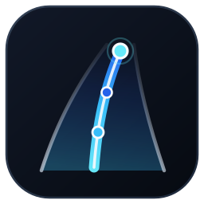
</p>

<h1 align="center">NeuroPilot</h1>

<p align="center">
  All-in-one PyTorch framework for self-driving.<br />
  Planning, perception, segmentation, depth, and world models.
</p>

<p align="center">
  <a href="https://www.python.org/downloads/"></a>
  <a href="https://pytorch.org/"></a>
  <a href="https://developer.nvidia.com/tensorrt"></a>
  <a href="LICENSE"></a>
</p>

<p align="center">
  <a href="#demos">Demos</a> ·
  <a href="#install">Install</a> ·
  <a href="#quick-start">Quick Start</a> ·
  <a href="#pretrained-weights">Weights</a> ·
  <a href="#model-zoo">Model Zoo</a> ·
  <a href="#training">Training</a> ·
  <a href="#export-and-runtimes">Runtimes</a> ·
  <a href="#project-structure">Structure</a> ·
  <a href="#extending">Extending</a> ·
  <a href="#testing">Testing</a> ·
  <a href="#license">License</a>
</p>

<p align="center">
  <a href="assets/demos/hero.mp4">
    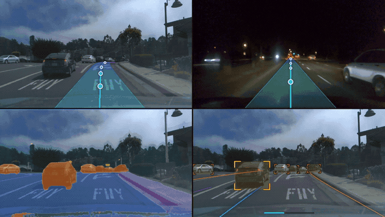
  </a>
  <br />
  <sub>
    Top: day and night E2E trajectory planning (<code>pilot_l</code>).
    Bottom: semantic segmentation (<code>seg_l</code>) and 3D multi-lane with CIPO detection (<code>pilot_l</code> + <code>cipo</code> + <code>drive</code>).
    Click any animated preview for the full-resolution MP4. All clips are sourced from <a href="https://github.com/commaai/comma2k19">comma2k19</a> (MIT).
  </sub>
</p>

NeuroPilot unifies end-to-end driving planners, multi-task perception, semantic segmentation, monocular depth, cabin monitoring, and world models under a single PyTorch YAML graph engine. Load pretrained checkpoints by name (`NeuroPilot("pilot_l.pt")`), train custom multi-task networks on your own dataset, or export models to ONNX, TorchScript, and TensorRT 10.

---

## Demos

All demonstration videos and previews use zero-text overlays on MIT-licensed `comma2k19` driving sequences. Click any GIF to open the full MP4 clip, or view the high-resolution still snapshots.

| Demo | Animated Preview (click for full MP4) | Still | Models & Measured Speed (RTX 3060) |
| :--- | :---: | :---: | :--- |
| Flagship 2x2 Suite | [](assets/demos/hero.mp4) | [JPG](assets/demos/hero.jpg) | `pilot_l.pt` (day & night E2E) + `seg_l.pt` (`EoMT-Large`) + `cipo.pt` + `drive.pt` + 3D multi-lane. |
| Day / Night E2E Planning | [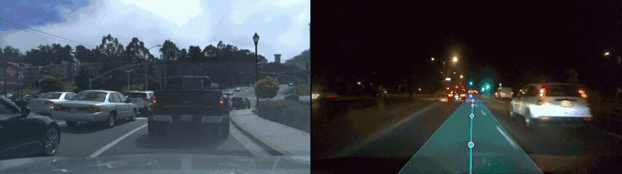](assets/demos/day_night.mp4) | [Frames](assets/demos/frames/) | `pilot_l.pt` (381.6M). 58.5s continuous day/night driving at 30 to 35 FPS. |
| Perception, Seg & Depth | [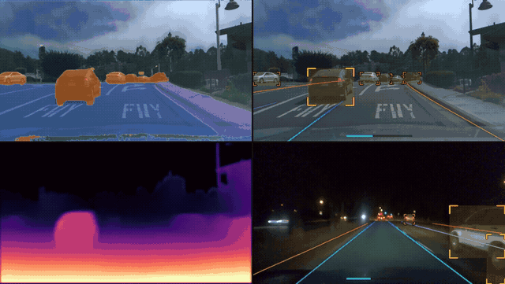](assets/demos/perception.mp4) | [JPG](assets/demos/perception.jpg) | `seg_l.pt` (10.4 FPS FP16), `cipo.pt`, `drive.pt`, `depth.pt`, and `pilot_l` 3D multi-lane (day & night). |
| Discrete World Tokenizer | [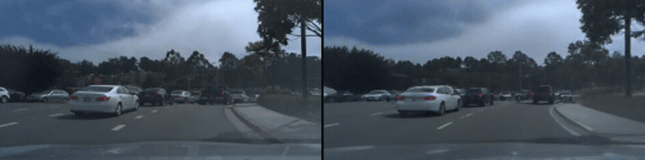](assets/demos/world_vq.mp4) | [JPG](assets/demos/world_vq.jpg) | `vq_enc.pt` + `vq_dec.pt` (72.4M). 128 discrete tokens/frame, 23.78 dB PSNR reconstruction. |

### Day & Night Trajectory Keyframes

| Straight Urban & Night Highway (`t = 4.7s`) | Curved Turn Behind Lead Pickup (`t = 14.6s`) |
| :---: | :---: |
| 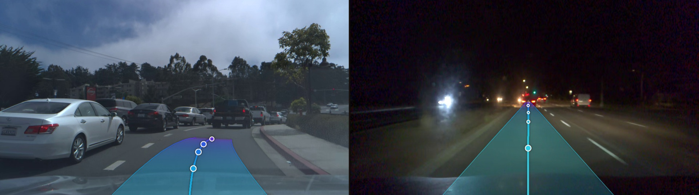 | 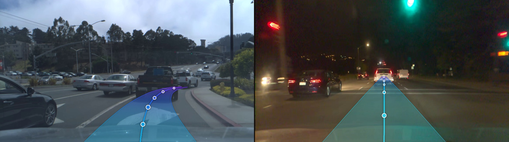 |

| Intersection & Lane Merge (`t = 38.0s`) | Sweep Curve & Dense Night Traffic (`t = 55.0s`) |
| :---: | :---: |
| 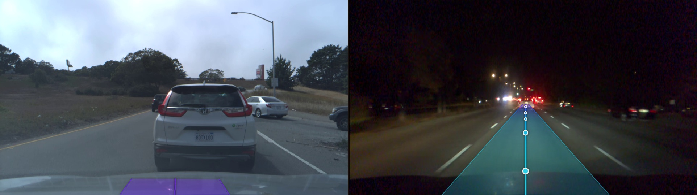 | 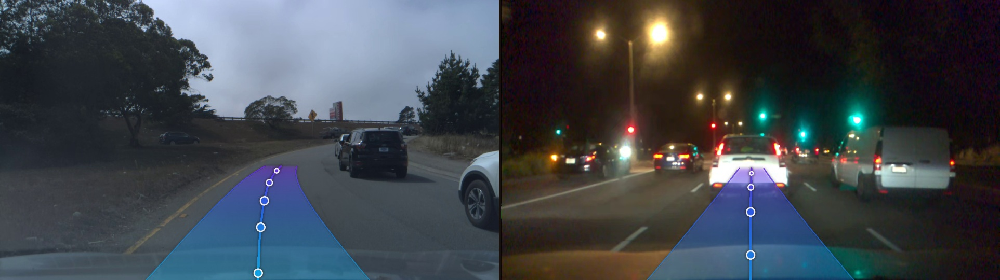 |

### High-Resolution Perception & Tokenizer Snapshots

| Multi-Task Perception (`seg_l` + 3D Multi-Lane + CIPO + Depth) | Discrete VQGAN Reconstruction (Original vs 128 Tokens) |
| :---: | :---: |
| 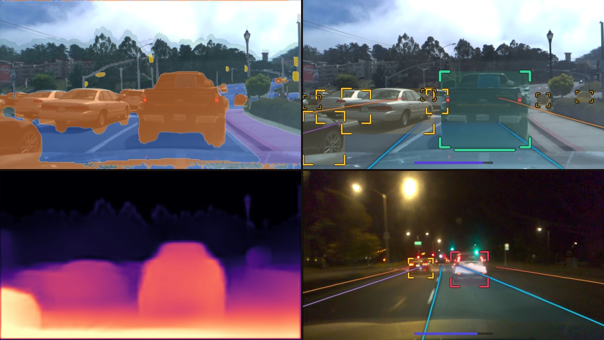 | 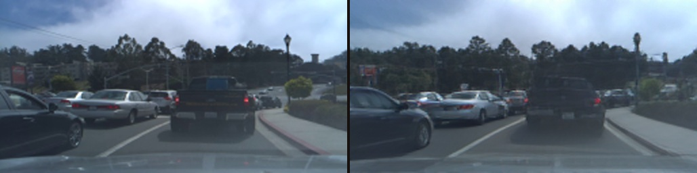 |

---

## Install

Requires Python 3.10+, PyTorch 2.0+, and `ffmpeg` (for video demo rendering). CUDA 11.8/12.x is recommended for GPU inference and training.

```bash
git clone https://github.com/vtnguyen04/neuralPilot.git
cd neuralPilot

# Recommended (uv)
uv sync

# Or standard editable install
pip install -e .
```

Optional developer dependencies (`pytest`, `ruff`, `mypy`):

```bash
uv sync --group dev
```

---

## Quick Start

### Python API

Pass any supported checkpoint name (`pilot_l.pt`, `seg_l.pt`, `cipo.pt`, `depth.pt`, ...) or `pretrained=True` to load pretrained weights automatically from local cache.

```python
from neuro_pilot import NeuroPilot

# 1. End-to-end 3D trajectory planning on video
planner = NeuroPilot("pilot_l.pt", device="cuda")
planner.predict_video("drive.hevc", out_mp4="trajectory.mp4")

# 2. Semantic segmentation (EoMT-Large SOTA, or use "seg.pt" for 88 FPS edge)
seg = NeuroPilot("seg_l.pt", device="cuda")
class_map = seg.predict("frame.jpg")["class_map"]  # (512, 896) uint8

# 3. Vehicle/CIPO detection, monocular 3D depth, ego-lane, and lead distance
boxes = NeuroPilot("cipo.pt", device="cuda").predict("frame.jpg")["boxes"]
depth = NeuroPilot("depth.pt", device="cuda").predict("frame.jpg")["depth"]
lane_pts = NeuroPilot("lane.pt", device="cuda").predict("frame.jpg")["points"]
lead = NeuroPilot("drive.pt", device="cuda").predict("frame.jpg")  # distance_m, curvature, cipo_prob

# 4. Discrete visual tokenizer (VQGAN encoder + decoder)
tokens = NeuroPilot("vq_enc.pt", device="cuda").predict("frame.jpg")["tokens"]
recon_bgr = NeuroPilot("vq_dec.pt", device="cuda").predict(tokens)["image_bgr"]

# 5. Export any model to ONNX or TorchScript
planner.export(format="onnx", file="pilot_l.onnx", opset=17)
```

### CLI Reference

| Command | Description |
| :--- | :--- |
| `neuropilot download --list` | List all checkpoints supported by the automatic hub |
| `neuropilot download seg_l pilot_l cipo depth` | Pre-fetch specific `.pt` checkpoints into cache |
| `neuropilot download --all --dir ./weights` | Download every supported checkpoint to a custom directory |
| `neuropilot train neuralPilot.yaml --data data.yaml --epochs 100 --batch 16` | Train a native multi-task driving model |
| `neuropilot predict video.mp4 --model weights/best.pt --save` | Run inference on images or videos |
| `neuropilot val --model weights/best.pt --data data.yaml` | Run validation metrics |
| `neuropilot export --model weights/best.pt --format onnx --imgsz 640` | Export to ONNX or TensorRT |
| `neuropilot benchmark --model weights/best.pt --imgsz 640` | Measure latency and throughput |

Render single/dual trajectory videos or the full 4-clip demo suite directly from the demo tool:

```bash
# Single or dual-panel 3D trajectory video
python -m neuro_pilot.tools.demo video \
  --pt ~/.cache/neuro_pilot/weights/pilot_l.pt \
  --video day.hevc --right_video night.hevc \
  --out assets/demos/day_night.mp4

# Full 4-clip showcase suite (hero, day_night, perception, world_vq)
python -m neuro_pilot.tools.demo suite \
  --day_video day.hevc --night_video night.hevc \
  --pt_root ~/.cache/neuro_pilot/weights/ --out_dir assets/demos/
```

---

## Pretrained Weights

Checkpoints are never committed to Git. [neuro_pilot/nn/zoo/hub.py](neuro_pilot/nn/zoo/hub.py) resolves weights in two tiers when you call `NeuroPilot("<key>.pt")`, `NeuroPilot("<key>", pretrained=True)`, `ModelZoo.download("<key>")`, or `neuropilot download <key>`:

1. **Local cache:** Checks `~/.cache/neuro_pilot/weights/<key>.pt` first and loads immediately with zero network traffic.
2. **Remote fetch:** Checks any configured `.pt` mirror (`NEUROPILOT_WEIGHTS_URL` or HuggingFace repo `NEUROPILOT_HF_REPO`), then falls back to the official permissive upstream weights (MIT / Apache-2.0) and converts them deterministically into `.pt` on first run.

| Environment Variable | Default | Purpose |
| :--- | :--- | :--- |
| `NEUROPILOT_CACHE_DIR` | `~/.cache/neuro_pilot/weights` | Directory for cached `.pt` checkpoints |
| `NEUROPILOT_HF_REPO` | `vtnguyen04/neuropilot-weights` | HuggingFace repo hosting prebuilt `.pt` mirrors |
| `NEUROPILOT_WEIGHTS_URL` | *(unset)* | Optional custom HTTPS base URL for `.pt` downloads |

---

## Model Zoo

### Modular YAML Graph Models (`neuro_pilot/cfg/models/zoo/`)

All 16 architectures are declared layer-by-layer in YAML and executed by `GraphModel` ([neuro_pilot/nn/zoo/graph.py](neuro_pilot/nn/zoo/graph.py)). Changing layer repeats, channel widths, or heads in YAML modifies the model directly without editing Python code.

| Key | Family | Params | Auto-Download | License | Description |
| :--- | :--- | ---: | :---: | :--- | :--- |
| `pilot_s` | planner | 34.3M | Yes | MIT | Dual-camera E2E planner (FastViT-T12 + 5L Transformer) |
| `pilot_l` | planner | 381.6M | Yes | MIT | Dual-camera E2E planner + 3D multi-lane & road edges (ConvNeXt-XL + 8L Transformer) |
| `pilot_nav` | planner | 393.7M | Yes | MIT | Map-guided dual-camera E2E planner with navigation map encoder |
| `driver` | cabin | 3.6M | Yes | MIT | Cabin driver monitoring (MobileNetV4, LHD/RHD heads) |
| `cipo` | perception | 9.3M | Yes | Apache-2.0 | 4-class vehicle and CIPO detector (PANet + decoupled DFL head) |
| `lane` | perception | 8.2M | Yes | Apache-2.0 | Row-anchor ego-lane detector |
| `drive` | perception | 10.6M | Yes | Apache-2.0 | Temporal Siamese lead distance and curvature estimator |
| `depth` | perception | 7.0M | Yes | Apache-2.0 | Monocular 3D depth (EfficientNet-B1 + separable DeepLabV3+) |
| `seg` | perception | 5.7M | Yes | MIT | Edge semantic segmentation (DDRNet23-Slim, 88 FPS) |
| `seg_l` | perception | 316.0M | Yes | MIT | Semantic segmentation (EoMT-Large DINOv2 ViT-L, 10.4 FPS FP16) |
| `jepa` | world | 310.0M | Yes | Apache-2.0 | V-JEPA ViT-L 3D-RoPE world model planner |
| `vq_enc` | world | 29.6M | Yes | MIT | Discrete VQGAN encoder (128x256 RGB to 8x16 tokens) |
| `vq_dec` | world | 42.8M | Yes | MIT | Discrete VQGAN decoder (8x16 tokens to 128x256 RGB) |
| `ae` | world | 128.2M | Config | MIT | Paired-camera ViT autoencoder (`f8c32`, 42.9M enc / 85.4M dec) |
| `dit` | world | scalable | Config | MIT | Video Dense DiT + inverse-dynamics plan head (`tiny` / `full`) |
| `gpt` | world | scalable | Config | MIT | Autoregressive token video world model (`tiny` / `full`) |

### Native Multi-Task Training Configs (`neuro_pilot/cfg/models/`)

For training joint trajectory, object detection, heatmap, and command classification models from scratch with Ultralytics-style scaling (`n`, `s`, `m`, `l`, `x`):

| Config | Purpose |
| :--- | :--- |
| [neuralPilot.yaml](neuro_pilot/cfg/models/neuralPilot.yaml) | Default MobileNetV4 + language-command fusion multi-task backbone |
| [neuralPilot_yolo11.yaml](neuro_pilot/cfg/models/neuralPilot_yolo11.yaml) | Pure Conv YOLO11 backbone without `timm` dependency |
| [neuralPilot_dual.yaml](neuro_pilot/cfg/models/neuralPilot_dual.yaml) | Dual-branch decoupled perception and driving control network |
| [neuralPilot_deformable.yaml](neuro_pilot/cfg/models/neuralPilot_deformable.yaml) | Deformable cross-attention trajectory head |
| [neuralPilot_cfr.yaml](neuro_pilot/cfg/models/neuralPilot_cfr.yaml) | Causal Feature Routing (CFR) architecture |
| [neuralPilot_video.yaml](neuro_pilot/cfg/models/neuralPilot_video.yaml) | Multi-frame temporal video clip training (`[B, T, C, H, W]`) |
| [neuralPilot_60wp.yaml](neuro_pilot/cfg/models/neuralPilot_60wp.yaml) | Dense 60-waypoint horizon trajectory configuration |

---

## Training

### 1. Train a Native Multi-Task Model

Supports FDAT (Frenet-Decomposed Anisotropic Trajectory) loss, Wing loss, uncertainty-weighted multi-task balancing, and optional JEPA / SIGReg representation regularization. See [examples/train.py](examples/train.py) and [examples/train_temporal.py](examples/train_temporal.py) for complete scripts.

```python
from neuro_pilot import NeuroPilot

model = NeuroPilot("neuro_pilot/cfg/models/neuralPilot_deformable.yaml", scale="s")
model.train(
    data="data.yaml",
    epochs=100,
    batch=16,
    imgsz=640,
    use_fdat=True,
    use_uncertainty=True,
    lambda_traj=2.0,
    lambda_det=1.0,
    lambda_heatmap=1.5,
)
```

Dataset YAML format (`data.yaml`):

```yaml
path: ./dataset
train: images/train
val: images/val
nc: 14
names:
  0: car
  1: pedestrian
  2: stop_sign
```

### 2. Fine-Tune Any Pretrained Backbone (`CommandAdapter`)

Attach a trainable command-conditioned waypoint and control head directly through `NeuroPilot` onto any pretrained model (`pilot_s`, `pilot_l`, `jepa`, `driver`, ...):

```python
from neuro_pilot import NeuroPilot

model = NeuroPilot("pilot_s.pt")
adapter = model.attach_adapter(
    feat_dim=256,
    num_commands=4,
    num_waypoints=10,
    freeze_base=True,
)
```

---

## Export and Runtimes

`NeuroPilot(path)` detects the backend from the file suffix and preserves the same `predict()` output dictionary across all four runtimes.

| Format | Backend | Notes |
| :--- | :--- | :--- |
| `.pt` | PyTorch | Training, fine-tuning, and FP32/FP16 inference |
| `.onnx` | ONNX Runtime | CPU and CUDA providers with automatic task discovery |
| `.torchscript` | TorchScript | C++ / LibTorch deployment |
| `.engine` | TensorRT 10 | FP16/INT8 dynamic multi-input profile builds via [trt_builder.py](neuro_pilot/engine/trt_builder.py) |

```python
from neuro_pilot import NeuroPilot

model = NeuroPilot("depth.pt", device="cuda")
onnx_path = model.export(format="onnx", file="depth.onnx", opset=17)
ts_path = model.export(format="torchscript", file="depth.torchscript")

# Reload any compiled artifact directly with the same API
ort_model = NeuroPilot(onnx_path, device="cuda")
depth_map = ort_model.predict("frame.jpg")["depth"]
```

For edge deployment on NVIDIA Jetson, see [examples/jetson_inference_onnx.py](examples/jetson_inference_onnx.py) and [examples/jetson_inference_trt.py](examples/jetson_inference_trt.py).

---

## Project Structure

```text
neuro_pilot/
├── cfg/models/
│   ├── neuralPilot*.yaml         # Native joint multi-task training architectures
│   └── zoo/*.yaml                # 16 layer-by-layer modular Zoo YAML graphs
├── nn/zoo/
│   ├── graph.py                  # Generic GraphModel YAML executor
│   ├── hub.py                    # 2-tier automatic weight downloader & cache
│   ├── parity.py                 # ONNX-to-PyTorch conversion & numerical parity verifier
│   ├── losses.py                 # LaplaceNLL, MHPLaplaceLoss, FlowMatchingLoss, WaypointLoss
│   ├── blocks/                   # Shared atomic blocks (CNN, ViT, EoMT, VQ, EffNet, Planner)
│   └── converters/               # Deterministic ONNX & safetensors weight converters
├── engine/
│   ├── model.py                  # Unified NeuroPilot entry point
│   ├── tasks.py                  # Plug-and-play driving tasks (planner, seg, depth, lane, world, driver, bfmc)
│   ├── predictors/               # Stateful domain predictors (planner, perception, world)
│   ├── backend/                  # AutoBackend (PyTorch, ONNX Runtime, TorchScript, TensorRT 10)
│   ├── trt_builder.py            # Multi-input TensorRT 10 trtexec builder
│   ├── video.py                  # Streaming driving video inference & projection runner
│   └── zoo.py                    # ModelZoo facade & CommandAdapter fine-tuning head
├── utils/
│   ├── camera.py                 # Intrinsics, extrinsic RPY calibration, virtual view warp
│   ├── viz.py                    # 2x supersampled 3D drivable trajectory corridor renderer
│   └── overlay.py                # 3D multi-lane, AR CIPO brackets, segmentation & depth overlays
└── tools/demo.py                 # CLI for single/dual trajectory and 4-clip demo suite rendering
```

---

## Extending

### Add a Custom Model Architecture

1. Register any custom `nn.Module` block in `neuro_pilot/nn/zoo/blocks/` with `@BLOCK_REGISTRY.register("MyBlock")`.
2. Declare your layer list in `neuro_pilot/cfg/models/zoo/my_model.yaml` (`inputs`, `backbone`, `head`, `outputs`).
3. Build directly with `NeuroPilot("neuro_pilot/cfg/models/zoo/my_model.yaml")`.

### Add a Driving Task

Subclass `GraphDrivingTask` in [neuro_pilot/engine/tasks.py](neuro_pilot/engine/tasks.py) and decorate with `@Registry.register_task("my_task")`.

### Add a Dataset

Register any `BaseDrivingDataset` subclass with `@register_dataset("my_dataset")` in `neuro_pilot/data/datasets/` without modifying any factory code.

---

## Testing

```bash
# Run full Zoo, multi-backend, video visualizer, hub, and guardrail suite
pytest tests/zoo/ -k "not parity" -v

# Lint check
ruff check neuro_pilot/nn/zoo neuro_pilot/engine/predictors neuro_pilot/utils/viz.py neuro_pilot/utils/overlay.py neuro_pilot/tools/demo.py tests/zoo
```

---

## License

Licensed under the [Apache License 2.0](LICENSE). Third-party architectures, pretrained weight attributions, and dataset redistribution rules are documented in [THIRD_PARTY_LICENSES.md](THIRD_PARTY_LICENSES.md). Full version history is in [CHANGELOG.md](CHANGELOG.md).

Author: Vo Thanh Nguyen ([GitHub](https://github.com/vtnguyen04) · [thcs2nguyen@gmail.com](mailto:thcs2nguyen@gmail.com))
