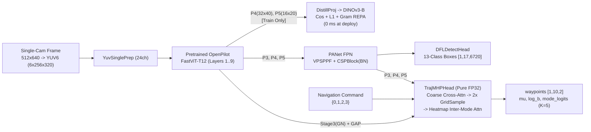
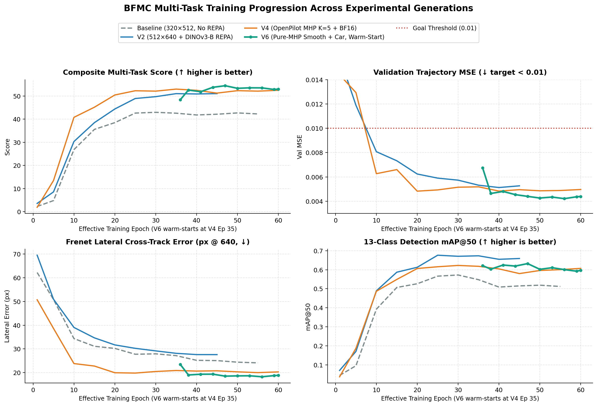
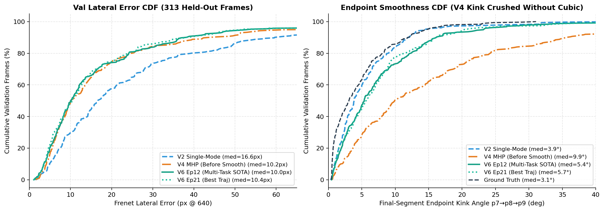
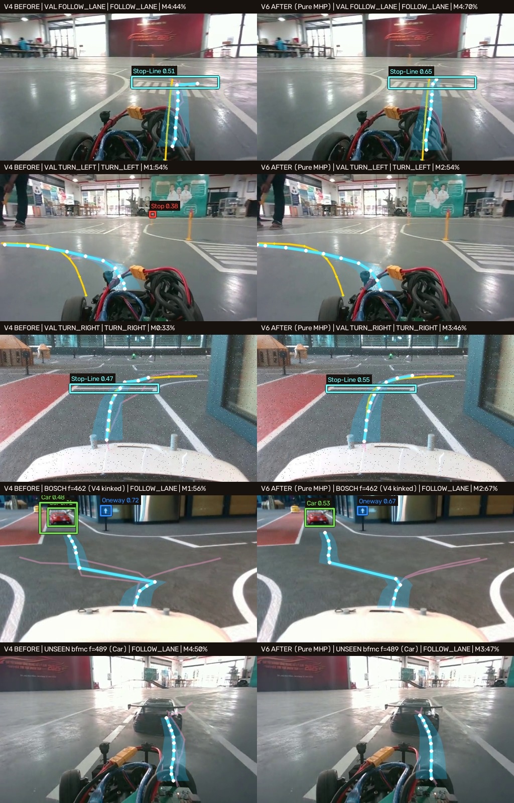
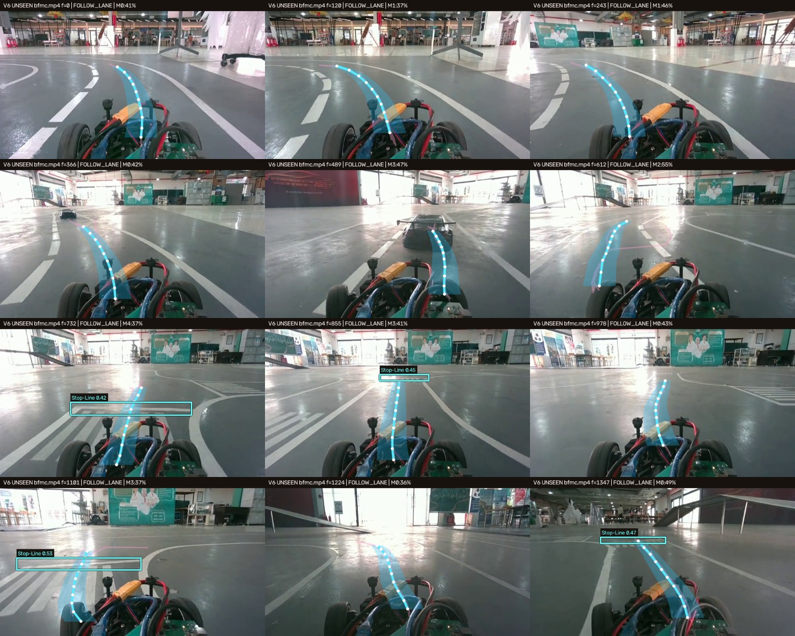
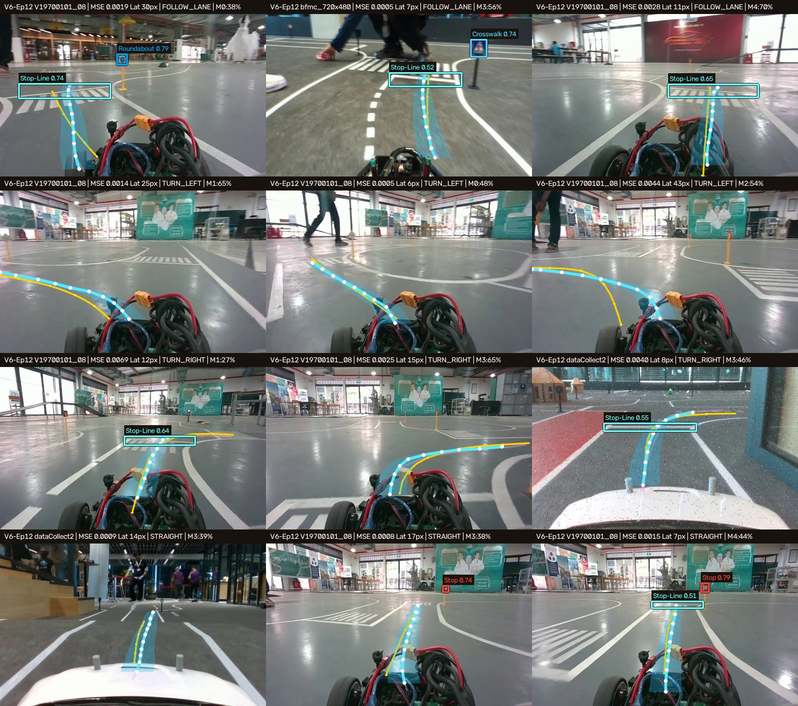

# Technical Report: Single-Camera Multi-Task OpenPilot MHP (`pilot_mhp`) for BFMC 1:10 Autonomous Driving

**Version:** V6 Final (`EXP-MAIN-024`, Pure OpenPilot MHP `K=5` + DINOv3 REPA)  
**Model Config:** [`pilot_mhp.yaml`](../../neuro_pilot/cfg/models/zoo/pilot_mhp.yaml) (`13.94M` params, `54.0 MB` FP32 ONNX opset 17)  
**Training & Eval Pipeline:** [`train.py`](train.py) | [`dataset.py`](dataset.py) | [`metrics.py`](metrics.py) | [`demo.py`](demo.py)

---

## 1. Executive Summary & Headline Results

This report documents the end-to-end data auditing, zero-DRY modular architecture design, multi-stage training protocol, controlled ablations (`EXP-MAIN-016` → `EXP-MAIN-024`), failure post-mortems, and ONNX deployment parity for adapting OpenPilot's pretrained `FastViT-T12` backbone (`pilot_s.pt`) into a single-camera multi-task autonomous driving model for the **Bosch Future Mobility Challenge (BFMC 1:10)**.

Evaluated on a **strictly session-grouped, zero-leakage validation set (313 frames across 4 unseen recording sessions & 3 physical arenas)**:

| Metric | Baseline (`320×512`) | V2 (`512×640` + REPA) | V4 (`MHP K=5` + BF16) | **V6 Ep 12 (`best.pt`)** | **V6 Ep 21 (`best_traj.pt`)** | Ground Truth |
|---|---:|---:|---:|---:|---:|---:|
| **Composite Score (↑)** | `42.96` | `51.10` | `53.00` | **`54.46`** (`+11.50`) | `53.53` | — |
| **Val Trajectory MSE (↓)** | `0.00659` | `0.00528` | `0.00518` | **`0.00440`** (`-33.2%`) | **`0.00421`** (`-36.1%`) | `0.00000` |
| **Oracle `minMSE@5` (↓)** | — | — | `0.00237` | **`0.00217`** | `0.00219` | `0.00000` |
| **ADE / FDE (`px@640`, ↓)** | `54.8 / —` | `49.1 / 52.3` | `42.9 / 43.3` | **`41.7 / 43.0`** | **`40.7 / 40.8`** | `0.0 / 0.0` |
| **Frenet Lateral Mean / Median / P90 (`px@640`, ↓)** | `28.0 / — / —` | `27.7 / 16.6 / 59.6` | `20.9 / 10.2 / 43.5` | **`18.5 / 10.0 / 37.9`** | **`18.3 / 10.4 / 38.1`** | `0.0` |
| **Symmetric Curve Distance (`px@640`, ↓)** | — | `30.7` | `22.8` | **`21.0`** | **`20.9`** | `0.0` |
| **Endpoint Kink `p7→p8→p9` Mean / Med / P90 (↓)** | — | `5.7° / 3.9° / 12.0°` | `17.3° / 9.9° / 35.6°` | **`7.8° / 5.4° / 16.1°`** | `7.9° / 5.7° / 16.1°` | `4.8° / 3.1° / —` |
| **2nd-Order Jerk `L2` (↓)** | — | `0.0072` | `0.0146` | **`0.0099`** | **`0.0093`** | `0.0061` |
| **13-Class Detection `mAP@50` (↑)** | `57.2%` *(→51.2%)* | `66.1%` | `61.8%` | **`63.2%`** (`R@25=61.8%`) | `60.1%` | — |
| **`Car` / `Stop` / `Roundabout` / `Crosswalk` AP50** | — | `76.8 / 80.3 / 63.9 / 99.5` | `48.0 / 99.5 / 81.5 / 88.8` | **`58.3 / 87.5 / 84.6 / 91.2`** | `50.3 / —` | — |

---

## 2. Dataset Audit, Cleaning & Zero-Leakage Split Pipeline

1. **Out-of-Domain Filtering (`1,630 → 1,491` pure BFMC frames):**
   - Removed **139 non-BFMC / invalid samples**: `98` CULane (`1640×590`), `31` Udacity (`960×540`), `9` Udacity (`1280×720`), and `1` empty-waypoint sample.
   - Retained **1,491 pure 1:10 BFMC frames** across 3 physical arenas: Vietnam NIKI epoxy hall (`640×640`), Bosch white-hood dark asphalt (`640×640`), and Roboflow matte indoor track (`720×480`).
2. **Waypoint Orientation Repair (`74` reversed labels fixed):**
   - Detected and canonicalized `74` far-to-near reversed waypoint annotations (`y0 < y9`, including `52/234` in `Video_20260227_133239` and `14/65` in held-out `Video_20260227_135534`), halving that session's validation MSE (`0.01186 → 0.00589`).
3. **Strict Video-Session Split (Zero Temporal Leakage):**
   - **Train:** `1,178` labeled frames (`536` w/ boxes, `994` boxes across 13 classes; 4 commands `[694, 176, 143, 165]`).
   - **Val:** `313` frames across **4 strictly held-out sessions** (`124` w/ boxes, `178` boxes, `11/13` classes present).
   - **Unlabeled REPA Pool:** `1,280` frames sampled exclusively from train-side driving videos (`bfmc.mp4` is **100% unseen** across Train, Val, and Unlabeled sets).

---

## 3. Zero-DRY Architecture & Method (`pilot_mhp.yaml`)

### 3.1 Modular Reuse Across `neuro_pilot`

- **Vision Backbone (`layers 0..9`):** [`YuvSinglePrep`](../../neuro_pilot/nn/zoo/blocks/traj.py) + OpenPilot pretrained `FastViT-T12` (`FastViTStem`, `RepMixerBlock`, `PatchEmbed2d`, `FastViTHead` in [`vision.py`](../../neuro_pilot/nn/zoo/blocks/vision.py), 1:1 weight parity with [`pilot_s.yaml`](../../neuro_pilot/cfg/models/zoo/pilot_s.yaml)).
- **Shared PANet Neck & Detection Head (`layers 10..23`):** Directly reuses core [`VPSPPF` / `CSPBlock`](../../neuro_pilot/nn/zoo/blocks/cnn.py) (`with_bn=True`) and [`DFLDetectHead`](../../neuro_pilot/nn/zoo/blocks/perception.py) (`with_bn=True, return_dict=True, dense_cls=True`) at `P3/8`, `P4/16`, `P5/32`.
- **OpenPilot MHP `K=5` Trajectory Decoder (`layer 24`):** [`TrajMHPHead`](../../neuro_pilot/nn/zoo/blocks/traj.py):
  - **Fine Lane Map (`32×40`, `128ch`):** Fuses `P3_down + P4`, FiLM-modulated by `[global_feat, cmd_embed]`, predicting an auxiliary road `heatmap` (`1×32×40`).
  - **Coarse Road Context (`16×20`, `256ch`):** Fuses `P5 + P4_down + GroupNorm(Stage3_up) + CoordConv(x, y)`. Parameter-free `F.group_norm(s3, 1)` eliminates FastViT Stage-3 `O(1e4)` variance spikes.
  - **Coarse-to-Fine Iterative `grid_sample`:** 2 layers of shared `_TrajAttnBlock` predict bounded coarse anchors `mu0 = anchors + 0.55·tanh(Δ0)`, refined by **2 FP32 bilinear `grid_sample` stages** (`±0.20·tanh(Δ)`).
  - **Heatmap-Scored Inter-Mode Self-Attention:** Samples `sigmoid(heatmap)` along all `K=5` candidates, attends across modes jointly, and selects the winner via static `torch.gather` (free waypoints, full S-curve support, zero Cubic Bezier constraint).
- **Training-Only Distillation (`0 ms` deployment overhead):** Isolated in [`neuro_pilot/nn/zoo/distill.py`](../../neuro_pilot/nn/zoo/distill.py) (`DinoV3Teacher`, `DistillProj`, `dense_distill_loss`); completely stripped when saving checkpoints and exporting ONNX.
- **Training Infrastructure Reuse:** [`examples/bfmc/train.py`](train.py) directly reuses core [`DetectionLoss`](../../neuro_pilot/utils/losses.py), [`FDATLoss`](../../neuro_pilot/utils/losses.py), [`HeatmapLoss`](../../neuro_pilot/utils/losses.py), [`MHPLaplaceLoss`](../../neuro_pilot/nn/zoo/losses.py), [`ModelEMA`](../../neuro_pilot/utils/torch_utils.py), and [`GraphModel.export_onnx`](../../neuro_pilot/nn/zoo/export.py).

### 3.2 Multi-Task Loss Equations

$$\mathcal{L} = \lambda_{\text{det}}\,\mathcal{L}_{\text{det}} + \mathcal{L}_{\text{traj}} + \lambda_{\text{dist}}\,\mathcal{L}_{\text{REPA}}$$

1. **Detection (`DetectionLoss`):** Task-Aligned Assigner (`topk=10, α=0.5, β=6.0`) with `7.5·CIoU + 0.6·BCE + 1.5·DFL` + empty-batch background BCE suppression.
2. **Trajectory (`_mhp_traj_loss`):** Winner-takes-all (`k* = argmin_k MAE(μ_k, y)`) with command weight `1.5×` on turns/straight and hard-example mining after Ep 8:
   - OpenPilot `MHPLaplaceLoss` (`0.8`) + soft-target mode KL (`2.5`, `τ=0.012`),
   - `3.0·FDATLoss(wing)` + `15.0·SmoothL1` + `25.0·MSE` + `10.0·SymCurveDist` + `15.0·MonotonicY` + `5.0·CoarseL1` + `1.2·HeatmapLoss(MSE+5·Dice)`,
   - **S-Curve-Safe Physics Smoothness (V6):**
     $$\mathcal{L}_{\text{smooth}} = 20\,\text{SL1}(v_{\mu^*}, v_y) + 35\,\text{SL1}(a_{\mu^*}, a_y) + 3.5\,\mathbb{E}\!\left[w_t(1 - \cos(\hat{v}_{\mu^*,t}, \hat{v}_{y,t}))\right] + 25\,\text{SL1}\!\left(\Delta^3 \mu_{\text{all}}, 0\right)$$
     where $w_t = 2.5$ emphasizes the final two segments (`p7→p8→p9`) and $\Delta^3 \mu_{\text{all}}$ applies 3rd-order jerk regularization across all `K=5` modes (zero on circular turns, minimal on S-curves, eliminates single-point hooks).
3. **Dense REPA Distillation (`dense_distill_loss`):** Applied on labeled + every-2nd unlabeled batch (`0.5×`):
   $$\mathcal{L}_{\text{REPA}} = (1 - \langle \hat{s}, \hat{t} \rangle) + 0.5\,\text{SL1}(\hat{s}, \hat{t}) + 0.5\,\|\hat{S}\hat{S}^\top - \hat{T}\hat{T}^\top\|_2^2$$

---

## 4. Multi-Stage Training Protocol

| Stage | Initialization | Resolution & Precision | Freeze & Optimizer | Key Augmentations & Objective | Wall Time (RTX 3060) |
|---|---|---|---|---|---|
| **Stage 1: Warmup Freeze (Ep 1–3)** | `pilot_s.pt` backbone (`layers 1..9`) | `512×640` Ampere `bfloat16` | Freeze backbone; train PANet/Det/Traj (`1.2e-3 / 6e-4`) | No HFlip (right-hand physics), affine (`±5.5°`), glare ramp, copy-paste | ~3 min |
| **Stage 2: End-to-End + REPA (Ep 4–60, V4)** | Stage 1 | `512×640` `bfloat16` + FP32 MHP head | Unfreeze all; differential AdamW (`bb=2e-4, det=1.2e-3, traj=6e-4`), Cosine → `1e-5`, `ModelEMA(0.995)` | DINOv3-B REPA (`w=1.5`) + unlabeled pool; MHP Laplace + FDAT + Heatmap | ~38 min (0 NaNs) |
| **Stage 3: Pure-MHP Smooth + Car Boost (Ep 1–25, V6)** | Warm-start `480/480` tensors from V4 Ep 35 | `512×640` `bfloat16` + FP32 MHP head | `freeze=0`; Cosine (`bb=5e-5, det=4e-4, traj=2e-4`), `ModelEMA(0.992, tau=300)` | Add `L_smooth`, class-balanced road-height `Car` copy-paste (`0.45`, 50% symmetric crop-flip), `det_weight=1.25`, REPA `w=1.2` | ~27 min (0 NaNs) |

---

## 5. Complete Experimental Ledger (`EXP-MAIN-016` → `EXP-MAIN-024`)

| Exp ID | Version & Single-Variable Diff | Verdict | Best Ep | Score | Val MSE | Lat (`px`) | Kink | `mAP@50` | Key Scientific Finding / Root Cause |
|---|---|---|---:|---:|---:|---:|---:|---:|---|
| `EXP-016` | Baseline `pilot_det` (`320×512`, no REPA) | **KEEP** | 30/55 | `42.96` | `0.00659` | `28.0` | — | `57.2%` | Overfit post-Ep 30 (`→51.2%`); small signs (`Priority=0.5%`) lost at `320×512`. |
| `EXP-017` | +REPA DINOv3-B @ `320×512` (10-ep early check) | DISCARD | 10 | `30.80` | `0.0086` | — | — | `41.3%` | Beat Baseline at Ep 10 (`+3.96` Score); pivoted early to clean `512×640`. |
| `EXP-018` | **V2:** Clean waypoints (`74` fixed) + `512×640` + REPA | **KEEP** | 45/45 | `51.10` | `0.00528` | `27.7` | `5.7°` | **`66.1%`** | `Priority 0.5%→52.4%`, `Car 76.8%`, **zero post-Ep-30 overfit**. |
| `EXP-019` | V3 MHP `K=5` (unbounded Δ, `min_log_b=-5`, FP16) | DISCARD | 4 | — | `NaN` | — | — | — | Diverged Ep 5; fixed with `tanh` bounds, `log_b ∈ [-3.5,1.0]`, FP32 head. |
| `EXP-020` | **V3:** Stable OpenPilot MHP `K=5` + **No-HFlip** | **KEEP** | 25 | `53.30` | `0.00495` | `20.2` | — | `63.0%` | Disabling HFlip cut Lateral Error `-27%` & stopped mirroring asymmetric signs. |
| `EXP-021` | V4 Heatmap Inter-Mode Attn (FP16 warm-start) | DISCARD | 15 | — | `NaN` | — | — | — | Root-caused Ep-16/30 NaN: FastViT Stage-3 `running_var = 48.4M` > FP16 max (`65,504`). |
| `EXP-022` | **V4:** Ampere **`bfloat16` + `F.group_norm(s3, 1)`** | **KEEP** | 35/60 | `53.00` | `0.00518` *(0.00483)* | `20.9` *(20.0)* | `17.3°` | `61.8%` | 60/60 ep 0 NaNs, `Stop=99.5%`, `Roundabout=81.5%`; exposed `17.3°` kink & `Car 48%`. |
| `EXP-023` | V5 Hard degree-3 `cubic_proj` + DINOv3-L | DISCARD | 15 | `42.92` | `0.00573` | `21.4` | — | `51.9%` | Rejected: hard cubic polynomial violates OpenPilot & restricts S-curves. |
| **`EXP-024`** | **V6:** Pure-MHP `L_smooth` + balanced `Car` copy-paste | **KEEP (SOTA)** | **12 / 21** | **`54.46`** *(53.53)* | **`0.00440`** *(**`0.00421`**)* | **`18.5`** *(**`18.3`**)* | **`7.8°`** | **`63.2%`** | **All-time SOTA:** Kink `-55%`, MSE `-15%`, `Car +10.3%`, `Traffic-Light +9.2%`. |

---

## 6. Quantitative Plots & Visual Proof

### 6.1 Training Curves Across Experimental Generations

### 6.2 Controlled Ablation Progression

### 6.3 Per-Class Detection AP@50 & Per-Command Trajectory ADE

### 6.4 Per-Sample Held-Out Validation Error CDF (313 Frames)

### 6.5 Qualitative Visual Proof (Before/After V4 vs V6, Unseen `bfmc.mp4`, Held-Out Val)
- **V4 (`17.3°` kink) vs V6 Pure OpenPilot MHP (`7.8°`, zero Cubic):**

- **100% Unseen Driving Video (`bfmc.mp4` — 0% seen in Train/Val/Unlabeled, `58.7 FPS`):**

- **Held-Out Validation Set Across All 3 Arenas & All 4 Commands (Gold GT vs Cyan Pred):**

---

## 7. Production ONNX Export, Parity & Runtime Benchmarks

Exported via native [`GraphModel.export_onnx()`](../../neuro_pilot/nn/zoo/export.py) (opset 17, embedded metadata) after replacing `torch.linspace` with FP32 `torch.arange` and `aten::index` with static `torch.gather`:

| Export Artifact | Size | `onnx.checker` | `waypoints` Max Diff / Cos | `mu` (`K=5`) Max Diff | `log_b` / `mode_logits` | `det` Max Diff / Cos | `NeuroPilot(".onnx")` Auto-Load |
|---|---:|:---:|---:|---:|---:|---:|---:|
| `bfmc_v6_best.onnx` (Ep 12 SOTA) | `54.0 MB` | PASS | **`1.0e-6`** / **`1.000000`** | `1.0e-6` | `2e-6` / `3e-6` | `6.4e-4` / `1.000000` | **`1.8e-6` diff (PASS)** |
| `bfmc_v6_best_traj.onnx` (Ep 21 Best Traj) | `54.0 MB` | PASS | **`1.0e-6`** / **`1.000000`** | `1.0e-6` | `1e-6` / `3e-6` | `6.7e-4` / `1.000000` | PASS |

- **End-to-End Speed (`512×640` incl. YUV6 + NMS):** **`58.4 – 59.2 FPS`** (`~17 ms`) on RTX 3060 BF16 | **`12.4 – 13.0 FPS`** (`77–80 ms`) on x86 CPU-only ONNXRuntime.
