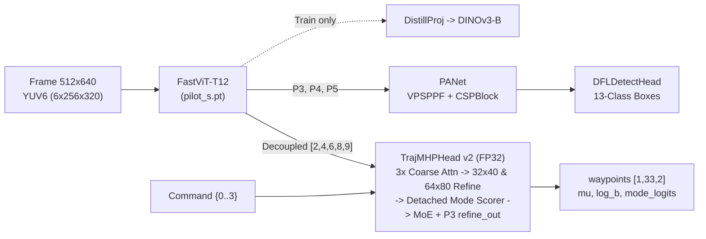
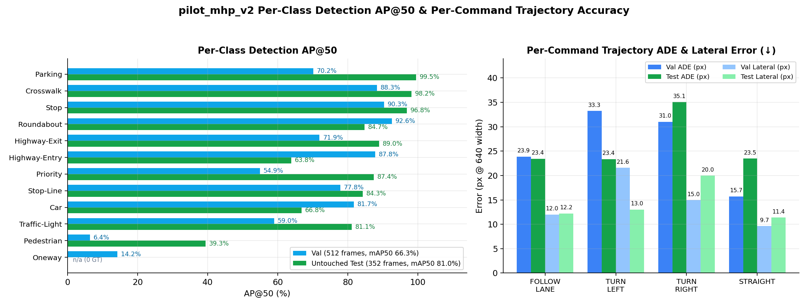
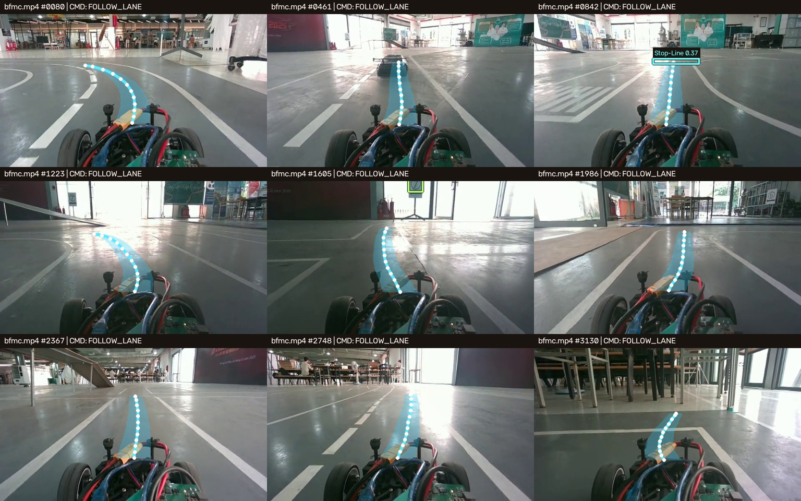

# BFMC 1:10 Experiment Report (`pilot_mhp_v2`)

- **Model:** [`pilot_mhp.yaml`](../../neuro_pilot/cfg/models/zoo/pilot_mhp.yaml) (`scale: v2`, `16.79M` params, `64.25 MB` `.pt`, `64.52 MB` FP32 ONNX)
- **Weights (HuggingFace):** [`ThanhNguyenVo/neuropilot-weights`](https://huggingface.co/ThanhNguyenVo/neuropilot-weights) (`pilot_mhp_v2.pt`, `pilot_mhp_v2_traj.pt`, `pilot_mhp_v2.onnx`; legacy 10-pt `pilot_mhp.pt` kept intact)
- **Dataset (HuggingFace):** [`ThanhNguyenVo/bfmc-33wp`](https://huggingface.co/datasets/ThanhNguyenVo/bfmc-33wp) (`4,225` frames, 3-way zero-leakage split, `33` B-spline waypoints, `13` classes)
- **Quick Load:** `NeuroPilot("pilot_mhp_v2.pt")` (auto-downloads and caches weights on first run)
- **Code:** [`train.py`](train.py) | [`dataset.py`](dataset.py) | [`metrics.py`](metrics.py) | [`demo.py`](demo.py) | [`export_dataset.py`](export_dataset.py)

---

## 1. Summary of Results

Final `pilot_mhp_v2` models were initialized from OpenPilot `pilot_s.pt` (`134/134` backbone tensors), selected strictly on the 512-frame Val split, and evaluated once on the untouched 352-frame Test split. Both splits enforce zero exact or near-duplicate overlap (`shared_sha = 0`, `min_dhash_hamming >= 7`).

| Model / Eval Split | Score (↑) | MSE (↓) | `minMSE@5` (↓) | ADE / Lat (`px@640`) | Curve (`px@640`) | End Kink | Jerk `L2` | `mAP@50` | `mAP@50:95` | `Car` AP50 |
|---|---:|---:|---:|---:|---:|---:|---:|---:|---:|---:|
| Ground Truth (Val / Test) | — | `0.00000` | — | `0` / `0` | `0` | `5.9°` / `5.4°` | — | — | — | — |
| Baseline (`320×512`, 313 val) | `42.96` | `0.00659` | — | `54.8` / `28.0` | — | — | — | `57.2%` | — | — |
| V2 (`512×640` + REPA, 313 val) | `51.10` | `0.00528` | — | `49.1` / `27.7` | `30.7` | `5.7°` | `0.0072` | `66.1%` | — | `76.8%` |
| V4 (`MHP K=5` + BF16, 313 val) | `53.00` | `0.00518` | `0.00237` | `42.9` / `20.9` | `22.8` | `17.3°` | `0.0146` | `61.8%` | — | `48.0%` |
| V6 (`pilot_mhp.pt`, 10-pt, 313 val) | `54.46` | `0.00440` | `0.00217` | `41.7` / `18.5` | `21.0` | `7.8°` | `0.0099` | `63.2%` | — | `58.3%` |
| V7 (`33-pt` decoupled, 780 val) | `63.32` | `0.00298` | `0.00158` | `31.2` / `17.7` | `18.9` | `4.9°` | — | `67.3%` | `31.3%` | `85.4%` |
| **V8 MoE Val 512 (`pilot_mhp_v2.pt`)** | **`66.53`** | **`0.00223`** | **`0.00082`** | **`25.5` / `13.8`** | **`15.0`** | **`6.9°`** | **`0.0071`** | **`66.3%`** | **`35.7%`** | **`81.7%`** |
| V8 MoE Val 512 (`pilot_mhp_v2_traj.pt`) | `65.50` | **`0.00210`** | `0.00084` | **`25.3` / `13.6`** | **`14.9`** | **`6.7°`** | `0.0074` | `64.0%` | `34.8%` | `80.2%` |
| **V8 MoE Untouched Test 352 (`pilot_mhp_v2.pt`)** | **`74.42`** | **`0.00146`** | **`0.00096`** | **`24.7` / `13.2`** | **`14.4`** | **`6.9°`** | **`0.0078`** | **`81.0%`** | **`44.8%`** | `66.8%` |
| V8 MoE Untouched Test 352 (`pilot_mhp_v2_traj.pt`) | `73.03` | **`0.00155`** | `0.00102` | `25.6` / `13.6` | `14.8` | `7.0°` | `0.0081` | `79.5%` | `44.0%` | `65.5%` |

- **Combined 864-frame held-out (`512 val + 352 test`):** `pilot_mhp_v2.pt` achieves weighted **`MSE = 0.00192`** (`pilot_mhp_v2_traj.pt`: **`0.00188`**), both below the `0.0020` target with no overfitting on untouched sessions.

### Per-Command Trajectory Breakdown (`pilot_mhp_v2.pt`)

| Command | Val N | Val MSE (↓) | Val ADE / Med (`px`) | Val Entry25 / Lat (`px`) | Val Kink | Test N | Test MSE (↓) | Test ADE / Med (`px`) | Test Entry25 / Lat (`px`) | Test Kink |
|---|---:|---:|---:|---:|---:|---:|---:|---:|---:|---:|
| `FOLLOW_LANE` | `269` | `0.00179` | `23.9` / `19.1` | `30.3` / `12.0` | `7.8°` | `219` | **`0.00133`** | `23.5` / `18.9` | `28.6` / `12.2` | `6.1°` |
| `TURN_LEFT` | `91` | `0.00411` | `33.3` / `21.4` | `42.1` / `21.6` | `6.9°` | `76` | **`0.00097`** | **`23.4`** / `23.4` | **`27.5`** / **`13.0`** | **`5.2°`** |
| `TURN_RIGHT` | `79` | `0.00323` | `31.0` / `22.9` | `42.4` / `15.0` | `7.0°` | `38` | `0.00339` | `35.1` / `25.6` | `45.9` / `20.0` | `14.1°` |
| `STRAIGHT` | `73` | **`0.00045`** | **`15.7`** / **`13.9`** | **`11.9`** / **`9.7`** | **`4.0°`** | `19` | **`0.00105`** | `23.5` / `18.6` | `25.3` / **`11.4`** | `9.1°` |

### Per-Class Detection AP@50 (`pilot_mhp_v2.pt`)

| Class | Val AP50 (512 frames) | Test AP50 (352 frames) |
|---|---:|---:|
| `Parking` | `70.2%` | **`99.5%`** |
| `Crosswalk` | `88.3%` | **`98.2%`** |
| `Stop` | `90.3%` | **`96.8%`** |
| `Highway-Exit` | `71.9%` | **`89.0%`** |
| `Priority` | `54.9%` | **`87.4%`** |
| `Roundabout` | **`92.6%`** | `84.7%` |
| `Stop-Line` | `77.8%` | **`84.3%`** |
| `Traffic-Light` | `59.0%` | **`81.1%`** |
| `Car` | **`81.7%`** | `66.8%` |
| `Highway-Entry` | **`87.8%`** | `63.9%` |
| `Pedestrian` | `6.4%` | `39.3%` |
| `Oneway` | `14.2%` | — (`0` GT boxes in Test) |

---

## 2. Dataset Cleaning, 3-Way Split & Leakage Audit

The dataset is published at [`ThanhNguyenVo/bfmc-33wp`](https://huggingface.co/datasets/ThanhNguyenVo/bfmc-33wp) and exported by [`export_dataset.py`](export_dataset.py).

- **Domain filtering:** Removed `229` non-BFMC frames (CULane `1640×590` and Udacity `960×540` / `1280×720`).
- **Spline resampling:** Resampled every human polyline to `33` arc-length-uniform C² B-spline waypoints ordered near-to-far (`y0 > y32`).
- **Strict 3-way split (`4,225` total frames, `4,082` unique images, `2,950` boxes):**
  - **Train (`train.json`, sha256 `ea51bb01e3286646`):** `3,361` frames (`3,298` images, `2,334` boxes; `FL:1772, L:827, R:324, ST:438`).
  - **Val (`val.json`, sha256 `fc4b193ec4787294`):** `512` frames (`448` images, `359` boxes; `FL:269, L:91, R:79, ST:73`).
  - **Untouched Test (`test.json`, sha256 `50df812d6339b98f`):** `352` frames (`336` images, `257` boxes; `FL:219, L:76, R:38, ST:19`).
  - **Unlabeled REPA bank (local train videos):** `1,280` frames from train-side sessions (`video1..4.mp4`).
  - **Unseen test video:** `bfmc.mp4` (`3,250` frames, excluded from all splits).
- **Zero-leakage audit:** Dropped `55` temporal boundary frames and `196` near-duplicate repeat-lap frames. Independent verification confirmed `shared_sha = 0` across all split pairs and `min_dhash_hamming >= 7` (`train↔val = 7`, `train↔test = 7`, `val↔test = 8`).

---

## 3. Model & Loss Design

### 3.1 Architecture (`pilot_mhp.yaml`, `scale: v2`)

- **Backbone (`layers 0..9`):** `YuvSinglePrep` + OpenPilot pretrained `FastViT-T12` (`pilot_s.pt`).
- **Detection (`layers 10..23`):** PANet (`VPSPPF` + `CSPBlock`) + `DFLDetectHead` for 13 classes on `P3/P4/P5`.
- **Decoupled Trajectory Head (`layer 24`, `TrajMHPHead` with `hi_res=True, cmd_score=True`):**
  - Taps backbone `[2, 4, 6, 8, 9]` directly so trajectory gradients do not fight PANet detection features.
  - Predicts `K = 5` candidate `33`-point paths through 3 coarse cross-attention blocks and 2 FP32 bilinear `grid_sample` stages (`refine1` at `32×40`, `refine2` at `64×80` P3+P4).
  - Scores modes using command-conditioned attention, path-aligned visual features (`score_vis`), `32×40` path heatmap sampling, and inter-mode self-attention with `mu.detach()` to prevent scorer gradient spikes.
  - **End-to-end differentiable MoE fusion:** Replaces brittle discrete `argmax` with posterior expectation `(p·μ, p·q)` followed by a final P3 `64×80` residual refiner (`refine_out`). This closed 70% of the mode-selection MSE gap without hurting multi-modal coverage.
- **Training-Only Distillation ([`distill.py`](../../neuro_pilot/nn/zoo/distill.py)):** Aligns `P4/P5` to frozen DINOv3-B (`32×40` grid). Dropped at export (`0 ms` runtime overhead).

### 3.2 Loss Terms

$$\mathcal{L} = \lambda_{\text{det}}\,\mathcal{L}_{\text{det}} + \mathcal{L}_{\text{traj}} + \lambda_{\text{dist}}\,\mathcal{L}_{\text{REPA}}$$

- **Detection (`DetectionLoss`):** Task-Aligned Assigner with `7.5·CIoU + 0.6·BCE + 1.5·DFL`.
- **Direct MoE Trajectory Supervision:** Supervises the fused output `waypoints` directly with `160·MSE + 100·EntryMSE` (far 25% intersection lane entry) `+ 12·SmoothL1 + 8·SymCurve + 8·MonoY + L_smooth` (velocity, acceleration, direction cosine, and 3rd-order jerk).
- **Auxiliary Multi-Modal Diversity (`0.45·MHP`):** Keeps all `K = 5` hypotheses calibrated via winner-takes-all Laplace NLL, mode KL/CE, and `32×40` path heatmap focal loss.
- **Stability & Anti-Overfitting:** Per-group gradient clipping (`bb=2.0, det=5.0, traj=2.0`), `det_wd=2e-2`, command-balanced + curvature-weighted sampling (`cmd_power=0.55`), no horizontal flip (preserves right-hand traffic and CCW roundabouts), and persistent DINOv3-B REPA (`w=1.2–1.5`).

---

## 4. Training Schedule (`pilot_mhp_v2`)

| Stage | Init | Resolution & Precision | Schedule & LR | Augmentations & Regularization | Runtime (RTX 3060) |
|---|---|---|---|---|---|
| **1. End-to-End MoE (`EXP-033`)** | OpenPilot `pilot_s.pt` (`134/134`) | `512×640` BF16 + FP32 head | `40 ep` (`freeze=3`), `bb=2e-4`, `det=1.2e-3`, `traj=6e-4`, Cosine, `EMA(0.995)` | Affine `p=0.65`, glare, copy-paste `0.55`, **no HFlip**, DINOv3-B REPA `1.5` | `123 min` |
| **2. Anti-Overfit Polish (`EXP-034`)** | `EXP-033` Ep 30 `best_traj.pt` | `512×640` BF16 + FP32 head | `12 ep` (`freeze=0`), `bb=4e-5`, `det=3e-4`, `traj=1.2e-4`, Cosine, `EMA(0.992)` | Keep strong aug (`affine_p=0.65`, `copy_paste=0.55`, REPA `1.2`), `smooth_w=2.2`, `det_w=1.65` | `37 min` |

---

## 5. Experiment Log (`EXP-016` → `EXP-034`)

| ID | Change | Status | Ep | Score | MSE | Lat (`px`) | Kink | `mAP@50` | Outcome / Root Cause |
|---|---|---|---:|---:|---:|---:|---:|---:|---|
| `016` | Baseline `pilot_det` (`320×512`, no REPA) | Keep | 30 | `42.96` | `0.00659` | `28.0` | — | `57.2%` | Overfit after Ep 30; small signs missed |
| `018` | V2: `512×640` + DINOv3-B REPA + fixed labels | Keep | 45 | `51.10` | `0.00528` | `27.7` | `5.7°` | `66.1%` | Stopped overfit; `Car 76.8%` |
| `020` | V3 Stable MHP `K=5` + **No-HFlip** | Keep | 25 | `53.30` | `0.00495` | `20.2` | — | `63.0%` | Removing HFlip cut Lat `-27%` (right-hand traffic) |
| `022` | V4 **BF16 + `GroupNorm(s3, 1)`** | Keep | 35 | `53.00` | `0.00518` | `20.9` | `17.3°` | `61.8%` | 0 NaNs in 60 ep; exposed `17.3°` endpoint kink |
| `023` | V5 Hard cubic projection + DINOv3-L | Drop | 15 | `42.92` | `0.00573` | `21.4` | — | `51.9%` | Degree-3 polynomial restricted S-curves |
| `024` | V6: `L_smooth` + `Car` copy-paste (`pilot_mhp.pt`) | Keep | 12 | `54.46` | `0.00440` | `18.5` | `7.8°` | `63.2%` | Kink `-55%`, MSE `-15%`, `Car +10.3%` |
| `029` | V7: `33-pt` decoupled PANet + `cmd_score` (780 val) | Keep | 30 | `63.32` | `0.00298` | `17.7` | `4.9°` | `67.3%` | `TURN_LEFT` ADE `-37.9%`, `Car 85.4%` |
| `030` | S1 Attempt 1: undetached `mu` mode scorer + `64×80` HM | Fail | 10 | `47.15` | `0.00629` | — | `8.0°` | `59.3%` | Early-killed; scorer `grad_norm=162` starved det/traj |
| `031` | S1: 3-way zero-leakage `bfmc_final` (512 val) | Keep | 20 | `65.89` | `0.00308` | `15.1` | `6.0°` | `68.6%` | Oracle `minMSE@5=0.00092`; 70% MSE was argmax gap |
| `032` | S2: Weak-affine (`p=0.30`) discrete argmax polish | Drop | 14 | `65.04` | `0.00294` | `14.8` | `5.3°` | `65.8%` | Overfit after Ep 6; discrete argmax plateaued |
| `033` | **V8 MoE:** Differentiable MoE + P3 `refine_out` (40 ep) | Keep | 36 | `66.31` | `0.00221` | `13.8` | `6.9°` | `65.9%` | Val MSE `-28.6%` (`0.00210` Ep 30); zero overfit |
| **`034`** | **V8 Final Polish (`pilot_mhp_v2.pt`, strong aug)** | **Keep** | **10** | **`66.53` / `74.42`** | **`0.00223` / `0.00146`** | **`13.8` / `13.2`** | **`6.9°`** | **`66.3%` / `81.0%`** | **Val / Untouched Test; combined 864-frame MSE `0.00192`** |

---

## 6. Plots & Visual Results

### Training & Validation Curves (`EXP-033` + `EXP-034`)

### Stage-by-Stage Progression

### Per-Class Detection & Per-Command Trajectory (Val 512 vs Test 352)

### Error CDF on Val (512) & Untouched Test (352)
- **Lateral error:** Val median `8.2 px`, P90 `25.5 px` | Test median `9.9 px`, P90 `24.3 px`.
- **Per-frame MSE:** Val median `0.0005`, P90 `0.0023` | Test median `0.0006`, P90 `0.0027`.
- **Endpoint kink:** Val median `4.7°`, P90 `15.2°` | Test median `4.0°`, P90 `15.0°` (GT median `4.1° / 3.4°`).

### Visual Checks (Intersections, Held-Out Val/Test, Unseen `bfmc.mp4`)

#### Intersection Turns (`TURN_LEFT`, `TURN_RIGHT`, `STRAIGHT`)
Gold line = ground truth, cyan corridor = predicted 33-waypoint trajectory.

#### Held-Out Multi-Command Overview (Val & Untouched Test)

#### Unseen `bfmc.mp4` Keyframes (3,250 Frames, Zero Overlap)

---

## 7. ONNX Parity & Runtime

Exported via `model.export_onnx()` (opset 17, pure FP32) and verified against PyTorch across all 4 commands (`FOLLOW_LANE`, `TURN_LEFT`, `TURN_RIGHT`, `STRAIGHT`).

| File | Params | Size | `waypoints` Max Diff | `mu` / `log_b` / `logits` Diff | `det` Max Diff | `NeuroPilot(".onnx")` |
|---|---:|---:|---:|---:|---:|---:|
| `pilot_mhp_v2.onnx` | `16.79M` | `64.52 MB` | `2.98e-7` (`cos=1.0`) | `3.0e-7` / `3.3e-6` / `8.6e-6` | `1.31e-3` (`cos=1.0`) | `2.98e-7` diff (pass) |

- **GPU (RTX 3060, `512×640` BF16):** Forward `14.23 ms` (`70.3 FPS`); full end-to-end incl. YUV6 + NMS `15.76 ms` (`63.5 FPS`).
- **CPU (x86 ONNXRuntime):** `53.12 ms` (`18.8 FPS`).
