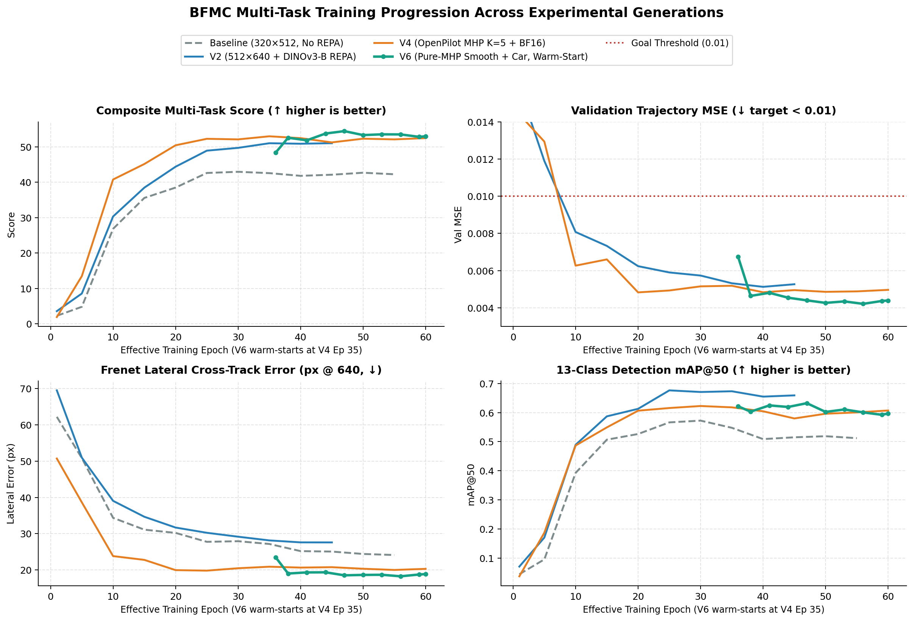
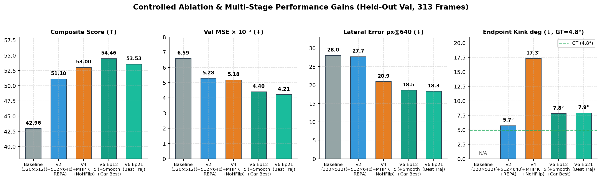
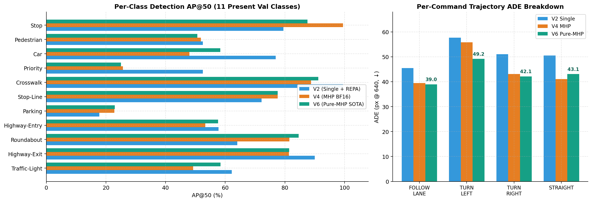
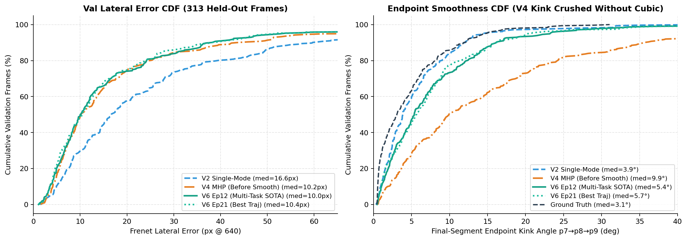
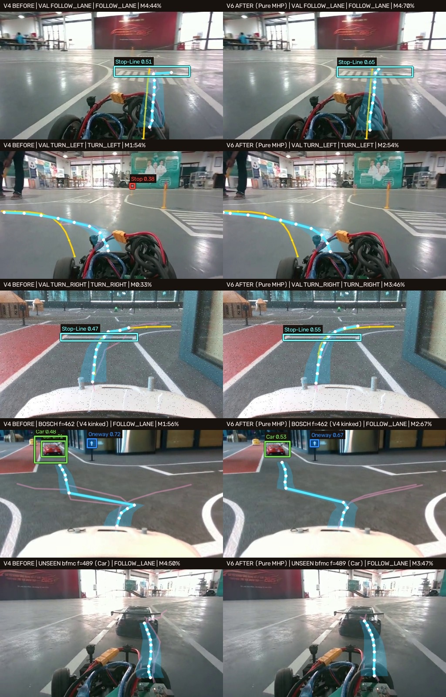
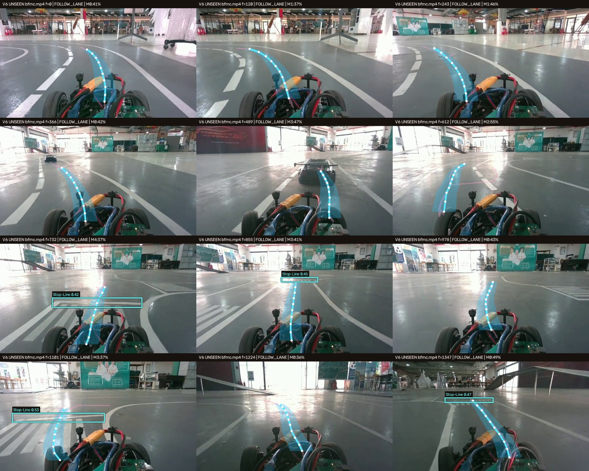
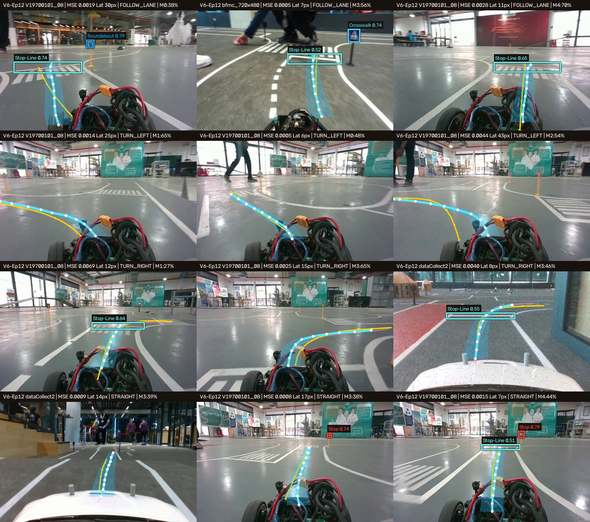

# BFMC 1:10 Experiment Report — V1 (`pilot_mhp`, 10-Waypoint)

> **Looking for the latest 33-waypoint End-to-End MoE model (`pilot_mhp_v2`)?** See [`REPORT_V2.md`](REPORT_V2.md).

- **Model:** [`pilot_mhp.yaml`](../../neuro_pilot/cfg/models/zoo/pilot_mhp.yaml) (`scale: v1`, `14.07M` params, `53.8 MB` `.pt`, `54.0 MB` FP32 ONNX)
- **Weights (HuggingFace):** [`ThanhNguyenVo/neuropilot-weights`](https://huggingface.co/ThanhNguyenVo/neuropilot-weights) (`pilot_mhp.pt`, `pilot_mhp_traj.pt`, `pilot_mhp.onnx`)
- **Quick Load:** `NeuroPilot("pilot_mhp.pt")` (auto-downloads and caches weights on first run)
- **Scope:** Legacy 10-waypoint baseline progression (`EXP-016` → `EXP-024`) plus TensorRT 10 & Jetson Orin Nano BF16 edge deployment (`EXP-025` → `EXP-028`).

---

## 1. Summary of Results (V1, 313-Frame Held-Out Val)

Evaluated on 313 held-out frames from 4 unseen recording sessions across 3 arenas.

| Model | Score (↑) | Val MSE (↓) | `minMSE@5` (↓) | ADE / Lat (`px@640`) | Curve (`px@640`) | End Kink `p7→p8→p9` | Jerk `L2` | `mAP@50` | `Car` AP50 |
|---|---:|---:|---:|---:|---:|---:|---:|---:|---:|
| Ground Truth | — | `0.00000` | — | `0` / `0` | `0` | `4.8°` | `0.0061` | — | — |
| Baseline (`320×512`) | `42.96` | `0.00659` | — | `54.8` / `28.0` | — | — | — | `57.2%` | — |
| V2 (`512×640` + REPA) | `51.10` | `0.00528` | — | `49.1` / `27.7` | `30.7` | `5.7°` | `0.0072` | `66.1%` | `76.8%` |
| V4 (`MHP K=5` + BF16) | `53.00` | `0.00518` | `0.00237` | `42.9` / `20.9` | `22.8` | `17.3°` | `0.0146` | `61.8%` | `48.0%` |
| **V6 Ep 12 (`pilot_mhp.pt`)** | **`54.46`** | **`0.00440`** | **`0.00217`** | **`41.7` / `18.5`** | **`21.0`** | **`7.8°`** | `0.0099` | **`63.2%`** | **`58.3%`** |
| V6 Ep 21 (`pilot_mhp_traj.pt`) | `53.53` | **`0.00421`** | `0.00219` | **`40.7` / `18.3`** | **`20.9`** | `7.9°` | **`0.0093`** | `60.1%` | `50.3%` |

---

## 2. Dataset Cleaning & Split (V1)

Raw labels exported from [`neuro_pilot_labeler`](https://github.com/vtnguyen04/neuro_pilot_labeler) contained mixed domains and reversed paths.

- **Filtered out 139 non-BFMC frames:** 98 CULane (`1640×590`), 40 Udacity (`960×540`, `1280×720`), and 1 empty label.
- **Kept 1,491 BFMC frames** from 3 arenas: Vietnam NIKI epoxy (`640×640`), Bosch white-hood asphalt (`640×640`), and Roboflow hall (`720×480`).
- **Fixed 74 reversed paths** labeled far-to-near (`y0 < y9`). Reversing them to near-to-far halved MSE on session `Video_20260227_135534` (`0.01186 → 0.00589`).
- **Split by recording session** (zero frame overlap between splits):
  - **Train:** `1,178` frames (`994` boxes, 13 classes, 4 commands `[694, 176, 143, 165]`).
  - **Val:** `313` frames from 4 unseen sessions (`178` boxes, 11 classes present).
  - **Unlabeled (for REPA):** `1,280` frames from train-side videos (`video1..4.mp4`).
  - **Unseen test video:** `bfmc.mp4` (`3,250` frames, excluded from all splits).

---

## 3. Model & Loss Design (V1, `scale: v1`)

### 3.1 Architecture (`pilot_mhp.yaml`, `scale: v1`)

- **Backbone (`layers 0..9`):** `YuvSinglePrep` + OpenPilot pretrained `FastViT-T12` (`pilot_s.pt`).
- **Detection (`layers 10..23`):** PANet (`VPSPPF` + `CSPBlock`) + `DFLDetectHead` for 13 classes on `P3/P4/P5`.
- **Trajectory (`layer 24`, `TrajMHPHead` with `cmd_score=False, hi_res=False`):**
  - Fuses PANet `P3+P4` (`[16, 19]`) into a `32×40` lane feature map and auxiliary path heatmap.
  - Fuses `P5 + P4 + GroupNorm(Stage3) + CoordConv` for 2 coarse cross-attention blocks over `K=5` modes.
  - Runs 2 FP32 bilinear `grid_sample` refinement stages (`±0.20·tanh`) on `32×40` `P3+P4`.
  - Scores all 5 modes via heatmap sampling and inter-mode self-attention, then selects `argmax` mode.
  - Predicts 10 normalized 2D image waypoints `(u, v) ∈ [0, 1]` directly.
- **Training-Only Distillation ([`distill.py`](../../neuro_pilot/nn/zoo/distill.py)):** Aligns `P4/P5` with frozen DINOv3-B (`32×40` grid at `512×640`). Dropped at export (`0 ms` runtime cost).

```mermaid
flowchart LR
    IMG["Frame 512x640<br/>YUV6 (6x256x320)"] --> BB["FastViT-T12<br/>(pilot_s.pt)"]
    BB -.->|"Train only"| REPA["DistillProj -> DINOv3-B"]
    BB -->|"P3, P4, P5"| PAN["PANet<br/>VPSPPF + CSPBlock"]
    PAN --> DET["DFLDetectHead<br/>13-Class Boxes"]
    CMD["Command {0..3}"] --> MHP
    PAN -->|"Coupled [16,19,22]"| MHP["TrajMHPHead v1 (FP32)<br/>2x Coarse Attn -> 2x GridSample (32x40)<br/>-> Heatmap Mode Scoring -> Argmax"]
    BB -->|"Stage3(GN) + GAP"| MHP
    MHP --> OUT["waypoints [1,10,2]<br/>mu, log_b, mode_logits"]
```

### 3.2 Loss Terms (V1)

$$\mathcal{L} = \lambda_{\text{det}}\,\mathcal{L}_{\text{det}} + \mathcal{L}_{\text{traj}} + \lambda_{\text{dist}}\,\mathcal{L}_{\text{REPA}}$$

- **Detection (`DetectionLoss`):** Task-Aligned Assigner with `7.5·CIoU + 0.6·BCE + 1.5·DFL`.
- **Trajectory (winner mode $\mu^*$):** `0.8·MHPLaplaceLoss` + `2.5·ModeKL` + `3.0·FDATLoss(wing)` + `15·SmoothL1` + `25·MSE` + `10·SymCurve` + `15·MonoY` + `5·CoarseL1` + `1.2·HeatmapLoss`.
- **Smoothness (added in V6):** Matches GT 1st/2nd derivatives on the winner and penalizes 3rd-order jerk across all 5 modes:
  $$\mathcal{L}_{\text{smooth}} = 20\,\text{SL1}(v_{\mu^*}, v_y) + 35\,\text{SL1}(a_{\mu^*}, a_y) + 3.5\,\mathbb{E}\!\left[w_t(1-\cos(\hat{v}_{\mu^*,t}, \hat{v}_{y,t}))\right] + 25\,\text{SL1}(\Delta^3\mu_{\text{all}}, 0)$$
  Weight $w_t = 2.5$ on the last two segments (`p7→p8→p9`) removes endpoint hooks without restricting S-curves.
- **REPA (`dense_distill_loss`):** Cosine + `0.5·SmoothL1` + `0.5·Gram MSE` on labeled and unlabeled batches.

---

## 4. Training Stages (V1)

| Stage | Init | Precision | LR & Schedule | Augmentations | Runtime (RTX 3060) |
|---|---|---|---|---|---|
| **1. Head Warmup (Ep 1–3)** | `pilot_s.pt` (`layers 1..9`) | `512×640` BF16 | Freeze backbone; head `1.2e-3` / traj `6e-4` | Affine `±5.5°`, glare, copy-paste, **no HFlip** | ~3 min |
| **2. Joint + REPA (Ep 4–60, V4)** | Stage 1 | `512×640` BF16 + FP32 head | Unfreeze all; `bb=2e-4`, `det=1.2e-3`, `traj=6e-4`, Cosine, `EMA(0.995)` | DINOv3-B REPA (`w=1.5`) + unlabeled frames | ~38 min |
| **3. Smooth + Car Fine-Tune (Ep 1–25, V6)** | Warm-start V4 Ep 35 | `512×640` BF16 + FP32 head | `freeze=0`; `bb=5e-5`, `det=4e-4`, `traj=2e-4`, Cosine, `EMA(0.992)` | Add `L_smooth`, class-balanced `Car` copy-paste (`0.45`), `det_w=1.25` | ~27 min |

---

## 5. Experiment Log (`EXP-016` → `EXP-028`)

### 5.1 Training & Architecture Progression (`EXP-016` → `EXP-024`)

| ID | Change | Status | Ep | Score | Val MSE | Lat (`px`) | Kink | `mAP@50` | Outcome / Root Cause |
|---|---|---|---:|---:|---:|---:|---:|---:|---|
| `016` | Baseline `pilot_det` (`320×512`, no REPA) | Keep | 30 | `42.96` | `0.00659` | `28.0` | — | `57.2%` | Overfit after Ep 30 (`→51.2%`); small signs lost |
| `017` | +DINOv3-B REPA at `320×512` | Stop | 10 | `30.80` | `0.00860` | — | — | `41.3%` | Beat baseline at Ep 10; switched to `512×640` |
| `018` | V2: `512×640` + REPA + 74 fixed labels | Keep | 45 | `51.10` | `0.00528` | `27.7` | `5.7°` | `66.1%` | Stopped overfit; `Priority 0.5%→52.4%`, `Car 76.8%` |
| `019` | V3 MHP (unbounded Δ, `log_b=-5`, FP16) | Fail | 4 | — | `NaN` | — | — | — | Exploded at Ep 5; fixed with `tanh` bounds + FP32 head |
| `020` | V3 Stable MHP `K=5` + **No-HFlip** | Keep | 25 | `53.30` | `0.00495` | `20.2` | — | `63.0%` | Removing HFlip cut Lat `-27%` (right-hand traffic) |
| `021` | V4 Inter-Mode Attn in FP16 | Fail | 15 | — | `NaN` | — | — | — | FastViT Stage-3 `running_var=48.4M` overflowed FP16 |
| `022` | V4 **BF16 + `GroupNorm(s3, 1)`** | Keep | 35 | `53.00` | `0.00518` | `20.9` | `17.3°` | `61.8%` | 0 NaNs in 60 ep; exposed `17.3°` kink and `Car 48%` |
| `023` | V5 Hard cubic projection + DINOv3-L | Stop | 15 | `42.92` | `0.00573` | `21.4` | — | `51.9%` | Dropped: degree-3 polynomial restricts S-curves |
| **`024`** | **V6: `L_smooth` + balanced `Car` copy-paste** | **Keep** | **12** | **`54.46`** | **`0.00440`** | **`18.5`** | **`7.8°`** | **`63.2%`** | Kink `-55%`, MSE `-15%`, `Car +10.3%` (Ep 21 MSE `0.00421`) |

### 5.2 TensorRT & Jetson Orin Nano Edge Deployment (`EXP-025` → `EXP-028`)

| ID | Target Hardware & Engine | Measured Speed | Parity & Stability Findings |
|---|---|---|---|
| `025` | RTX 3060 TensorRT 10.14 FP16 (`32 MB`) | `160.0 FPS` (`6.06 ms` GPU) | `0` NaNs on 313 val; `0.38 px` mean drift vs PyTorch (`Score 53.66`) |
| `026` | Jetson Orin Nano `sm87` TRT 10.3 FP16 (`32 MB`) | `132.8 FPS` GPU / `103.9 FPS` E2E | `0.41 px` max diff vs ONNX across 4 commands (`9.60 ms` full E2E) |
| `027` | Jetson Orin Nano full `3,250`-frame `bfmc.mp4` | `81.2 FPS` TRT / `72.4 FPS` + ByteTrack | Verified RealSense `680×384` YUV6 parity with training |
| **`028`** | **Jetson Orin Nano `sm87` TRT 10.3 BF16 (`52.3 MB`)** | **`76.8 FPS`** (`13.02 ms`, p95 `13.35 ms`) | **Fixed dark-frame FP16 NaNs** (`0/229` NaNs vs `7/20` FP16); live RealSense + UDP verified |

---

## 6. Plots & Visual Results (V1)

### Training Curves

### Stage-by-Stage Comparison

### Per-Class Detection & Per-Command Trajectory

### Val Error CDF (313 Frames)
- **Lateral error:** V6 median `10.0 px`, P90 `37.9 px` (V2: `16.6 / 59.6 px`).
- **Endpoint kink:** V6 median `5.4°`, P90 `16.1°` (V4: `9.9° / 35.6°`; GT median: `3.1°`).

### Visual Checks (V4 vs V6, Unseen `bfmc.mp4`, Held-Out Val)

---

## 7. ONNX Parity & Runtime (V1)

Exported via `model.export_onnx()` (opset 17, pure FP32 after replacing `torch.linspace` with `torch.arange` and `aten::index` with `torch.gather`).

| File | Size | `waypoints` Max Diff | `mu` / `log_b` / `logits` Diff | `det` Max Diff | `NeuroPilot(".onnx")` |
|---|---:|---:|---:|---:|---:|
| `pilot_mhp.onnx` | `54.0 MB` | `1.0e-6` (`cos=1.0`) | `1e-6` / `2e-6` / `3e-6` | `6.4e-4` (`cos=1.0`) | `1.8e-6` diff (pass) |

- **GPU (RTX 3060, `512×640` BF16, end-to-end incl. YUV6 + NMS):** `58.4 – 59.2 FPS` (`~17 ms`).
- **CPU (x86 ONNXRuntime):** `12.4 – 13.0 FPS` (`77–80 ms`).
- **Jetson Orin Nano (`sm87`, TensorRT 10.3 BF16):** `76.8 FPS` (`13.02 ms`).
