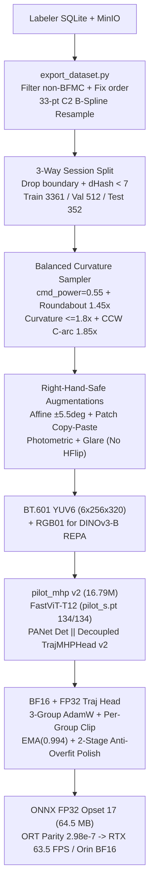
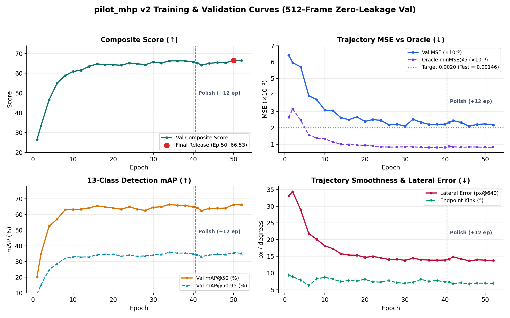
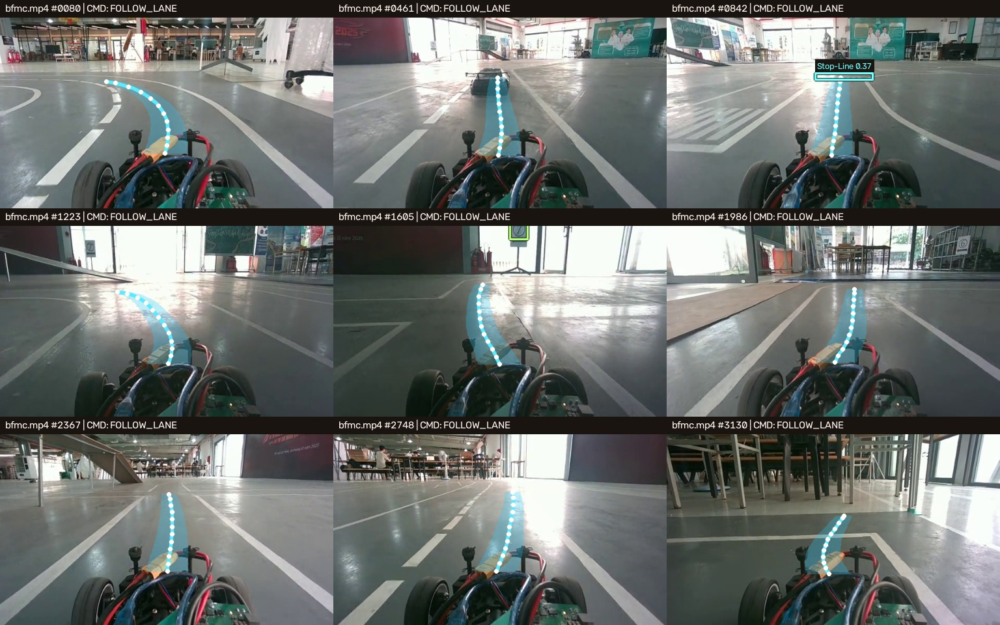

# BFMC 1:10 Experiment Report — V2 (`pilot_mhp_v2`, 33-Waypoint End-to-End MoE)

> **Looking for the legacy 10-waypoint V1 baseline and Jetson Orin TRT benchmarks?** See [`REPORT_V1.md`](REPORT_V1.md).

- **Model:** [`pilot_mhp.yaml`](../../neuro_pilot/cfg/models/zoo/pilot_mhp.yaml) (`scale: v2`, `16.79M` params, `64.25 MB` `.pt`, `64.52 MB` FP32 ONNX)
- **Weights (HuggingFace):** [`ThanhNguyenVo/neuropilot-weights`](https://huggingface.co/ThanhNguyenVo/neuropilot-weights) (`pilot_mhp_v2.pt`, `pilot_mhp_v2_traj.pt`, `pilot_mhp_v2.onnx`)
- **Dataset (HuggingFace):** [`ThanhNguyenVo/bfmc-33wp`](https://huggingface.co/datasets/ThanhNguyenVo/bfmc-33wp) (`4,225` frames, 3-way zero-leakage split, `33` B-spline waypoints, `13` classes)
- **Quick Load:** `NeuroPilot("pilot_mhp_v2.pt")` (auto-downloads and caches weights on first run)
- **Code:** [`export_dataset.py`](export_dataset.py) | [`dataset.py`](dataset.py) | [`train.py`](train.py) | [`metrics.py`](metrics.py) | [`demo.py`](demo.py) | [`traj.py`](../../neuro_pilot/nn/zoo/blocks/traj.py)

---

## 1. Final Results (Zero-Leakage Val & Untouched Test)

Final `pilot_mhp_v2` checkpoints were initialized from OpenPilot `pilot_s.pt` (`134/134` backbone tensors), selected strictly on the 512-frame Val split, and evaluated once on the untouched 352-frame Test split (`shared_sha = 0`, `min_dhash_hamming >= 7`).

| Checkpoint & Split | Score (↑) | MSE (↓) | `minMSE@5` (↓) | ADE / Lat (`px@640`) | Curve (`px@640`) | End Kink | Jerk `L2` | `mAP@50` | `mAP@50:95` | `Car` AP50 |
|---|---:|---:|---:|---:|---:|---:|---:|---:|---:|---:|
| Ground Truth (Val / Test) | — | `0.00000` | — | `0` / `0` | `0` | `5.9°` / `5.4°` | — | — | — | — |
| **Val 512 — `pilot_mhp_v2.pt` (Ep 10)** | **`66.53`** | **`0.00223`** | **`0.00082`** | **`25.5` / `13.8`** | **`15.0`** | **`6.9°`** | **`0.0071`** | **`66.3%`** | **`35.7%`** | **`81.7%`** |
| Val 512 — `pilot_mhp_v2_traj.pt` (Ep 06) | `65.50` | **`0.00210`** | `0.00084` | **`25.3` / `13.6`** | **`14.9`** | **`6.7°`** | `0.0074` | `64.0%` | `34.8%` | `80.2%` |
| **Untouched Test 352 — `pilot_mhp_v2.pt`** | **`74.42`** | **`0.00146`** | **`0.00096`** | **`24.7` / `13.2`** | **`14.4`** | **`6.9°`** | **`0.0078`** | **`81.0%`** | **`44.8%`** | `66.8%` |
| Untouched Test 352 — `pilot_mhp_v2_traj.pt` | `73.03` | **`0.00155`** | `0.00102` | `25.6` / `13.6` | `14.8` | `7.0°` | `0.0081` | `79.5%` | `44.0%` | `65.5%` |

- **Combined 864-frame held-out (`512 val + 352 test`):** `pilot_mhp_v2.pt` achieves **`MSE = 0.00192`** (`pilot_mhp_v2_traj.pt`: **`0.00188`**), both below the `0.0020` target with zero overfitting on unseen sessions.

### 1.1 Per-Command Trajectory Breakdown (`pilot_mhp_v2.pt`)

| Command | Val N | Val MSE (↓) | Val ADE / Med (`px`) | Val Entry25 / Lat (`px`) | Val Kink | Test N | Test MSE (↓) | Test ADE / Med (`px`) | Test Entry25 / Lat (`px`) | Test Kink |
|---|---:|---:|---:|---:|---:|---:|---:|---:|---:|---:|
| `FOLLOW_LANE` | `269` | `0.00179` | `23.9` / `19.1` | `30.3` / `12.0` | `7.8°` | `219` | **`0.00133`** | `23.5` / `18.9` | `28.6` / `12.2` | `6.1°` |
| `TURN_LEFT` | `91` | `0.00411` | `33.3` / `21.4` | `42.1` / `21.6` | `6.9°` | `76` | **`0.00097`** | **`23.4`** / `23.4` | **`27.5`** / **`13.0`** | **`5.2°`** |
| `TURN_RIGHT` | `79` | `0.00323` | `31.0` / `22.9` | `42.4` / `15.0` | `7.0°` | `38` | `0.00339` | `35.1` / `25.6` | `45.9` / `20.0` | `14.1°` |
| `STRAIGHT` | `73` | **`0.00045`** | **`15.7`** / **`13.9`** | **`11.9`** / **`9.7`** | **`4.0°`** | `19` | **`0.00105`** | `23.5` / `18.6` | `25.3` / **`11.4`** | `9.1°` |

### 1.2 Per-Class Detection AP@50 (`pilot_mhp_v2.pt`)

| Class | Val AP50 (512 frames) | Test AP50 (352 frames) |
|---|---:|---:|
| `Parking` | `70.2%` | **`99.5%`** |
| `Crosswalk` | `88.3%` | **`98.2%`** |
| `Stop` | `90.3%` | **`96.8%`** |
| `Highway-Exit` | `71.9%` | **`89.0%`** |
| `Priority` | `54.9%` | **`87.4%`** |
| `Roundabout` | **`92.6%`** | `84.7%` |
| `Stop-Line` | `77.8%` | **`84.3%`** |
| `Traffic-Light` | `59.0%` | **`81.1%`** |
| `Car` | **`81.7%`** | `66.8%` |
| `Highway-Entry` | **`87.8%`** | `63.9%` |
| `Pedestrian` | `6.4%` | `39.3%` |
| `Oneway` | `14.2%` | — (`0` GT boxes in Test) |

---

## 2. End-to-End V2 Pipeline Overview



---

## 3. Dataset Construction & Leakage Audit (`bfmc-33wp`)

Published at [`ThanhNguyenVo/bfmc-33wp`](https://huggingface.co/datasets/ThanhNguyenVo/bfmc-33wp) via [`export_dataset.py`](export_dataset.py).

- **Domain filtering:** Removed `229` non-BFMC frames (CULane `1640×590` and Udacity `960×540` / `1280×720`).
- **Trajectory standardization:** Reversed any far-to-near polylines to near-to-far (`y0 > y32`) and resampled every curve to `T = 33` arc-length-uniform C² B-spline waypoints `(u, v) ∈ [0, 1]`.
- **Strict 3-way split (`4,225` total frames, `4,082` unique images, `2,950` boxes):**
  - **Train (`train.json`, sha256 `ea51bb01e3286646`):** `3,361` frames (`3,298` images, `2,334` boxes; `FL:1772, L:827, R:324, ST:438`).
  - **Val (`val.json`, sha256 `fc4b193ec4787294`):** `512` frames (`448` images, `359` boxes, 12 classes; `FL:269, L:91, R:79, ST:73`).
  - **Untouched Test (`test.json`, sha256 `50df812d6339b98f`):** `352` frames (`336` images, `257` boxes, 11 classes; `FL:219, L:76, R:38, ST:19`).
  - **Unlabeled REPA bank (local train videos):** `1,280` frames from train-side sessions (`video1..4.mp4`).
  - **Unseen test video:** `bfmc.mp4` (`3,250` frames, `54.17s @ 60 FPS`, excluded from all splits).
- **Zero-leakage guard:** Dropped `55` temporal boundary frames and `196` near-duplicate repeat-lap frames. Independent audit confirmed `shared_sha = 0` across all 3 split pairs and `min_dhash_hamming >= 7` (`train↔val = 7`, `train↔test = 7`, `val↔test = 8`).

---

## 4. V2 Method & Architecture Specification (`pilot_mhp.yaml`, `scale: v2`)

### 4.1 Architectural Changes from V1 to V2

| Component | V1 (`pilot_mhp.pt`, `14.07M`) | V2 (`pilot_mhp_v2.pt`, `16.79M`) | Impact |
|---|---|---|---|
| Feature taps | Coupled to PANet `[16, 19, 22]` | Decoupled backbone `[2, 4, 6, 8, 9]` | Removes det/traj gradient conflict; `+4.5 FPS` GPU, `+6.4 FPS` CPU |
| Waypoints | `T = 10` points | `T = 33` C² B-spline points | Accurate tight intersection and roundabout geometry |
| Spatial refine | `32×40` only (`2` coarse blocks) | `32×40` + `64×80` P3 `fine_hi` (`3` coarse blocks) | Sharper far-field lane-entry alignment |
| Mode scorer | Heatmap + inter-mode attn | `+` command token + visual path features + `mu.detach()` | Prevents `grad_norm=162` instability (`EXP-030`) |
| Final output | Discrete `argmax` over `K=5` | **Differentiable MoE `(p·μ, p·q)` + P3 `64×80` `refine_out`** | Cuts Val MSE `-28.6%` (`0.00294 → 0.00210`), Test `0.00146` |

### 4.2 Exact Forward Formulation of `TrajMHPHead` (`v2`)

The entire trajectory head executes in explicit FP32 (`autocast(enabled=False)`) to prevent BF16/FP16 grid-sampling and attention drift.

1. **Decoupled Multi-Scale Backbone Inputs (`layers 2, 4, 6, 8, 9`):**
   - `P3` (`64×80, 64ch`), `P4` (`32×40, 128ch`), `P5` (`16×20, 256ch`), `Stage3` (`8×10, 512ch`), and global pooled `GAP` (`512ch`).
   - Context conditioning vector concatenates global vision and discrete command embedding (`c ∈ {0..3}`):
     $$\mathbf{z}_{\text{ctx}} = \left[\text{Proj}_{\text{glob}}(\text{GAP}),\; \mathbf{e}_c\right] \in \mathbb{R}^{B \times 512}$$
2. **Command-FiLM Feature Pyramids (`32×40` `fine` & `64×80` `fine_hi`):**
   - Downsample `P3` and fuse with `P4` into `fine` (`32×40, 128ch`), modulated via bounded FiLM $\mathcal{F} \leftarrow \mathcal{F}(1 + \tanh\gamma) + \beta$.
   - Predict `32×40` auxiliary path heatmap logits $H = \text{Conv}_{1\times 1}(\mathcal{F}_{32\times 40})$.
   - Upsample `fine` to `64×80`, fuse with raw backbone `P3`, and apply a second bounded FiLM to build high-resolution lane map `fine_hi` ($\mathcal{F}_{64\times 80} \in \mathbb{R}^{B \times 128 \times 64 \times 80}$).
3. **Coarse Context Tokens (`16×20`) & 5-Mode Anchor Decoder:**
   - Apply `GroupNorm(s3, 1)` on Stage 3 before projection to prevent FastViT Stage-3 variance spikes (`running_var ≈ 48.4M`, `EXP-021`).
   - Concatenate `[P5, down(P4), up(s3), CoordConv]` at `16×20`, project to `d=256`, and apply FiLM to form spatial tokens $KV \in \mathbb{R}^{B \times 320 \times 256}$.
   - Initialize `K=5 × T=33` queries $Q = \mathbf{m}_k + \mathbf{w}_t$ with FiLM conditioning, run `3` Pre-LN self-attention + cross-attention + FFN blocks, and predict coarse hypotheses around 5 fanned prior curves ($x_k(t) = 0.50 + \alpha_k t^{1.4}$, $\alpha \in \{0, \pm 0.16, \pm 0.34\}$, $y(t)=0.84 - 0.44t$):
     $$\mu^{(0)} = \mu_{\text{anchor}} + 0.55\,\tanh(\text{Linear}(Q))$$
4. **Two-Stage High-Resolution Bilinear `grid_sample` Refinement:**
   - Stage 1 (`refine1`) samples $\mathcal{F}_{32\times 40}$ at $\mu^{(0)}$ (`align_corners=True`), fuses `[q, sampled, μ]`, runs waypoint self-attention + FFN, and outputs $\mu^{(1)} = \mu^{(0)} + 0.20\tanh(\Delta_1)$.
   - Stage 2 (`refine2`) repeats on $\mathcal{F}_{64\times 80}$ (`fine_hi`) to produce refined hypotheses $\mu \in \mathbb{R}^{B \times 5 \times 33 \times 2}$, normalized embeddings $Q_n$, and clamped Laplace scales $\log b \in [-3.5, 1.0]$.
5. **Detached Visual-Command Mode Scorer (`_score_modes`):**
   - Detaches coordinates $\tilde{\mu} = \text{stopgrad}(\mu)$ so mode-selection gradients never distort coordinate regression (`EXP-030` fix).
   - Samples `32×40` heatmap probabilities $\sigma(H)$ and `32ch` visual projections `score_vis(fine_hi)` along $\tilde{\mu}$.
   - Fuses 7 per-mode descriptors: full-path query mean, far-quarter (`tk=8`) entry query mean, global feature, 3 visual path-segment means (all, mid, far-quarter), dropout-regularized (`p=0.15`) command embedding, sampled heatmap vector, and flattened $\tilde{\mu}$.
   - Runs inter-mode self-attention (`mode_attn`) plus spatial cross-attention (`mode_block(m_tok, KV)`) to output mode logits $\ell \in \mathbb{R}^{B \times 5}$.
6. **Differentiable Posterior MoE Fusion + Final P3 `64×80` `refine_out`:**
   - Replaces brittle discrete `argmax` with posterior expectation across all `K = 5` modes followed by a dedicated P3 `64×80` residual refinement stage:
     $$p_k = \text{softmax}(\ell)_k, \qquad \bar{\mu} = \sum_{k=1}^{5} p_k \mu_k, \qquad \bar{q} = \sum_{k=1}^{5} p_k Q_{n,k}$$
     $$\hat{y} = \bar{\mu} + 0.20\,\tanh\!\left(\Delta_{\text{out}}\!\left(\text{RefineOut}(\bar{q},\, \bar{\mu},\, \mathcal{F}_{64\times 80})\right)\right)$$

### 4.3 Complete Loss Functions & Evaluation Score

$$\mathcal{L}_{\text{total}} = \lambda_{\text{det}}\,\mathcal{L}_{\text{det}} + \mathcal{L}_{\text{traj}} + \lambda_{\text{dist}}\,\mathcal{L}_{\text{REPA}}$$

- **Detection (`DetectionLoss`):** Task-Aligned Assigner with `7.5·CIoU + 0.85·BCE + 1.5·DFL` (zero-box images apply `0.5·BCE(scores, 0)`).
- **Per-Waypoint & Sample Weighting (`_mhp_traj_loss`):**
  - Linearly increasing horizon weight $w_h \in [0.85, 1.85]$ (normalized to mean `1.0`) emphasizes far intersection entry.
  - Intersection command weight $w_{\text{cmd}} = 2.0$ for `TURN_LEFT / TURN_RIGHT / STRAIGHT` (`1.0` for `FOLLOW_LANE`).
  - From Epoch 7 onward, online hard-example factor $w_{\text{hard}} = 1 + \text{clamp}(\|\hat{y} - y\|_1 / 0.05,\, 0,\, 2)$ multiplies $w_{\text{cmd}}$.
- **Trajectory Objective (`0.70` overall scale):**
  $$\mathcal{L}_{\text{traj}} = 0.70\Big(\underbrace{160\,\mathcal{L}_{\text{MSE}} + 100\,\mathcal{L}_{\text{EntryMSE}} + 12\,\mathcal{L}_{\text{SL1}} + 8\,\mathcal{L}_{\text{EntrySL1}} + 3\,\mathcal{L}_{\text{FDAT}} + 10\,\mathcal{L}_{\text{SymCrv}} + 12\,\mathcal{L}_{\text{MonoY}}}_{\text{Direct End-to-End MoE Output } \hat{y}} + \underbrace{0.45(\mathcal{L}_{\text{MHP}} + 3.5) + 2.0\,\mathcal{L}_{\text{KL}} + \mathcal{L}_{\text{WTA}} + 1.2\,\mathcal{L}_{\text{HM}}}_{\text{Auxiliary } K=5 \text{ Multi-Modal Diversity}} + \lambda_{\text{sm}}\,\mathcal{L}_{\text{smooth}}\Big)$$
  - `EntryMSE / EntrySL1` supervise the final quarter of waypoints (`indices 25..32`, `tail_k = 8`).
  - Soft mode target uses temperature $\tau = 0.003$: $q^*_k = \text{softmax}(-\text{MSE}_w(\mu_k, y) / 0.003)$.
  - `WTA aux` supervises the best individual expert $\mu^*$ and coarse $\mu^{(0)*}$ (`40·MSE + 8·SL1 + 4·CoarseSL1`).
  - **Density-invariant smoothness (`scale_t = (T-1)/9 = 3.56`):**
    $$\mathcal{L}_{\text{smooth}} = 20\,\text{SL1}(v_{\hat{y}}, v_y) + 32\,\text{SL1}(a_{\hat{y}}, a_y) + 4\,\mathbb{E}\!\left[w_{\text{seg}}(1 - \cos(\hat{v}_{\hat{y}}, \hat{v}_y))\right] + 25\,\text{SL1}(j_{\hat{y}}, 0) + 10\,\text{SL1}(j_{\mu_{\text{all}}}, 0)$$
    with $w_{\text{seg}} = 2.5$ on the final fifth of segments (`6` segments) to suppress endpoint hooks.
- **REPA Distillation (`dense_distill_loss`):** Cosine + `0.5·SmoothL1` + `0.5·Gram MSE` between `DistillProj(P4, P5)` and frozen DINOv3-B on labeled batches plus `0.5×` on unlabeled batches every 2 steps.
- **Frozen Composite Metric (`metrics.py`):**
  $$\text{Score} = 50 \cdot \text{mAP@50} + 50 \cdot \max\!\left(0,\; 1 - \frac{\text{ADE}}{0.12}\right)$$

---

## 5. Data Sampling, Augmentation & Anti-Overfit Training Pipeline

### 5.1 Balanced & Curvature-Weighted Sampler (`dataset.py`)
Each training frame receives sampling weight (clipped at `4.5×` median):
- **Minority commands:** $(1 / N_c)^{0.55}$ balances `TURN_RIGHT` (`324`) and `STRAIGHT` (`438`) against `FOLLOW_LANE` (`1,772`).
- **Annotated boxes:** `×1.25` when any bbox is present; additional `×1.45` when a `Roundabout` sign (`class 9`) is present.
- **High-curvature arcs:** `×min(1.8, 1 + 6·(dev - 0.045))` when max chord deviation exceeds `0.045`.
- **CCW roundabout C-arcs:** `×1.85` when path bows right (`x_max - x_0 > 0.06`) before sweeping left (`x_end < x_max - 0.03`).

### 5.2 Right-Hand-Safe Augmentations
- **Never horizontally flip full road frames** (BFMC enforces right-hand traffic and counter-clockwise roundabouts; `EXP-020` proved HFlip inflates lateral error `+27%`).
- **Synchronized Affine (`p = 0.65`):** scale `x ±14%`, `y ±12%`, shift `x ±8%`, `y ±6%`, roll `±5.5°` (`p = 0.6`), warping image, 33 waypoints, and box corners together.
- **Class-Balanced Copy-Paste (`p = 0.55`):** pastes `1–2` non-overlapping (`IoU <= 0.05`) traffic sign / car patches with 1px feathered edges; horizontal flip applied strictly to symmetric classes (`Pedestrian, Car, Priority, Crosswalk, Roundabout, Traffic-Light`).
- **Photometric:** HSV jitter (`p=0.85`), directional floor-glare lighting ramp (`p=0.40`, `±35%`), Gaussian blur (`p=0.12`), and Gaussian noise (`p=0.15`).

### 5.3 Optimization & Two-Stage Schedule

| Stage | Init | Schedule & Optimizer | Regularization & Weights | Runtime (RTX 3060) |
|---|---|---|---|---|
| **1. End-to-End MoE (`EXP-033`)** | OpenPilot `pilot_s.pt` (`134/134`) | `40 ep` (`freeze=3`, `warmup=3`, `bs=8`), AdamW (`bb=2e-4/wd=1e-2`, `det=1.2e-3/wd=2e-2`, `traj=6e-4/wd=1e-2`), Cosine to `0.02×`, `EMA(0.994, tau=300)` | Per-group clip (`bb=2, det=5, traj=2`), `affine_p=0.65`, `copy_paste=0.55`, `REPA=1.5`, `smooth_w=1.0`, `det_w=1.8` | `123 min` |
| **2. Anti-Overfit Polish (`EXP-034`)** | `EXP-033` Ep 30 `best_traj.pt` | `12 ep` (`freeze=0`, `bs=8`), AdamW (`bb=4e-5`, `det=3e-4`, `traj=1.5e-4`), Cosine, `EMA(0.994)` | **Keep strong aug** (`affine_p=0.65`, `copy_paste=0.55`, `REPA=1.2`), raise `smooth_w=2.2`, `det_w=1.65` | `37 min` |

---

## 6. V2 Experiments & Same-Split Ablation (`EXP-029` → `EXP-034`)

### 6.1 Controlled Ablation on Identical Zero-Leakage 512-Frame Val Split (`EXP-030` → `EXP-034`)

| ID | Variant (All `scale=v2`, 33-pt) | Status | Best Ep | Score | Val MSE (↓) | `minMSE@5` | ADE / Lat (`px`) | `TURN_LEFT` Ent25 | Kink | `mAP@50` | Key Takeaway |
|---|---|---|---:|---:|---:|---:|---:|---:|---:|---:|---|
| `030` | S1 Attempt 1: undetached `mu` + `64×80` HM + global clip | Fail | 10 | `47.15` | `0.00629` | — | `49.9` / — | — | `8.0°` | `59.3%` | Early-killed; scorer `grad_norm=162` starved det/traj |
| `031` | S1: Detached scorer + `32×40` HM + per-group clip (**argmax**) | Keep | 20 / 30 | `65.89` | `0.00308` *(0.00301)* | `0.00092` | `28.3` / `15.1` | `53.2 px` | `6.0°` | `68.6%` | Oracle `0.00092` proved 70% of MSE was discrete argmax gap |
| `032` | S2: Weak-affine (`p=0.30`) discrete **argmax** warm-start | Drop | 4 / 14 | `65.04` | `0.00294` | `0.00089` | `27.1` / `14.8` | `52.9 px` | `5.3°` | `65.8%` | Overfit after Ep 6; argmax hit hard ceiling |
| `033` | **V8 MoE:** Differentiable MoE + P3 `refine_out` (40 ep fresh) | Keep | 30 / 36 | `66.31` | `0.00221` *(0.00210)* | `0.00085` | `25.5` / `13.8` | **`40.9 px`** | `6.9°` | `65.9%` | **Val MSE `-28.6%`**, `TURN_LEFT` Ent25 **`-12 px`**, 0 overfit |
| **`034`** | **V8 Polish (`pilot_mhp_v2.pt`, strong aug kept, 12 ep)** | **Keep** | **10** | **`66.53`** | **`0.00223`** *(0.00210 Ep6)* | **`0.00082`** | **`25.5` / `13.8`** | **`42.1 px`** | **`6.9°`** | **`66.3%`** | **Untouched Test 352: `Score 74.42`, `MSE 0.00146`, `mAP@50 81.0%`** |

*(Precursor `EXP-029` validated 33-pt decoupled PANet + `cmd_score` on an earlier 780-frame Val split: `Score 63.32`, `MSE 0.00298`, `Kink 4.9°`, `mAP@50 67.3%`, before locking the strict 3-way `dHash >= 7` benchmark.)*

---

## 7. Plots, CDF & Visual Verification (V2)

### Training & Validation Curves (`EXP-033` 40 ep + `EXP-034` 12 ep)


### Progression: V1 Baseline → V8 End-to-End MoE


### Per-Class Detection & Per-Command Trajectory (Val 512 vs Test 352)


### Per-Frame Error CDF (Val 512 & Untouched Test 352)

| Split | Lateral Med / P90 (`px`) | ADE Med / P90 (`px`) | MSE Med / P90 | End Kink Med / P90 (GT Med) |
|---|---:|---:|---:|---:|
| **Val (512 frames)** | `8.2` / `25.5` | `19.7` / `41.5` | `0.0005` / `0.0023` | `4.7°` / `15.2°` (`4.1°`) |
| **Untouched Test (352 frames)** | `9.9` / `24.3` | `20.4` / `43.9` | `0.0006` / `0.0027` | `4.0°` / `15.0°` (`3.4°`) |


### Visual Checks (Gold = Ground Truth, Cyan = Predicted 33-Point Corridor)

#### Intersection Turns (`TURN_LEFT`, `TURN_RIGHT`, `STRAIGHT`)


#### Held-Out Multi-Command Overview (Val & Untouched Test)


#### Unseen `bfmc.mp4` Keyframes (`3,250` Frames, `54.17s @ 60 FPS`, Zero Overlap)


---

## 8. ONNX Parity, Speed & Edge Deployment Notes

Exported via `model.export_onnx()` (opset 17, pure FP32) and verified against PyTorch across all 4 commands (`FOLLOW_LANE`, `TURN_LEFT`, `TURN_RIGHT`, `STRAIGHT`).

| File | Params | Size | `waypoints` Max Diff | `mu` / `log_b` / `logits` Diff | `det` Max Diff | `NeuroPilot(".onnx")` |
|---|---:|---:|---:|---:|---:|---:|
| `pilot_mhp_v2.onnx` | `16.79M` | `64.52 MB` | `2.98e-7` (`cos=1.0`) | `3.0e-7` / `3.3e-6` / `8.6e-6` | `1.31e-3` (`cos=1.0`) | `2.98e-7` diff (pass) |

- **GPU (RTX 3060, `512×640` BF16):** Forward `14.23 ms` (`70.3 FPS`); full end-to-end incl. YUV6 + NMS `15.76 ms` (`63.5 FPS`); full 3,250-frame `bfmc.mp4` video demo rendered at `15.77 ms/frame` (`63.4 FPS`).
- **CPU (x86 ONNXRuntime):** `53.12 ms` (`18.8 FPS`).
- **Jetson Orin Nano (`sm87`):** Build TensorRT 10.3 engine with `--bf16` (per V1 `EXP-028`) to match FP32 exponent range and avoid FP16 NaNs on dark indoor frames.

---

## 9. Reproducible V2 CLI Recipe

```bash
# 1. Export 3-way zero-leakage 33-waypoint dataset (or download ThanhNguyenVo/bfmc-33wp)
python3 -m examples.bfmc.export_dataset \
  --db data/labeler.db --out-dir datasets/bfmc_33wp --num-waypoints 33 --dhash-gap 6

# 2. Stage 1: Train 40-epoch End-to-End MoE from OpenPilot pilot_s.pt (EXP-033)
python3 -m examples.bfmc.train \
  --arch pilot_mhp --scale v2 --pilot-s-pt pilot_s.pt \
  --train-json datasets/bfmc_33wp/train.json --val-json datasets/bfmc_33wp/val.json \
  --epochs 40 --freeze-epochs 3 --batch-size 8 \
  --lr-backbone 2e-4 --lr-head 1.2e-3 \
  --affine-prob 0.65 --copy-paste 0.55 --polish-epochs 0 \
  --distill --distill-weight 1.5 --save-dir runs/bfmc_moe

# 3. Stage 2: 12-epoch anti-overfit smoothness + detection polish (EXP-034)
python3 -m examples.bfmc.train \
  --arch pilot_mhp --scale v2 --resume-weights runs/bfmc_moe/best_traj.pt \
  --train-json datasets/bfmc_33wp/train.json --val-json datasets/bfmc_33wp/val.json \
  --epochs 12 --freeze-epochs 0 --batch-size 8 \
  --lr-backbone 4e-5 --lr-head 3e-4 \
  --affine-prob 0.65 --copy-paste 0.55 --polish-epochs 0 \
  --det-weight 1.65 --smooth-weight 2.2 \
  --distill --distill-weight 1.2 --save-dir runs/bfmc_moe_final

# 4. Export FP32 ONNX (opset 17) & render full-length 60 FPS video demo
python3 -m examples.bfmc.demo \
  --ckpt pilot_mhp_v2.pt \
  --video bfmc.mp4 --out-mp4 bfmc_v2_demo.mp4 --max-frames 0 --stride 1 \
  --export-onnx pilot_mhp_v2.onnx
```
