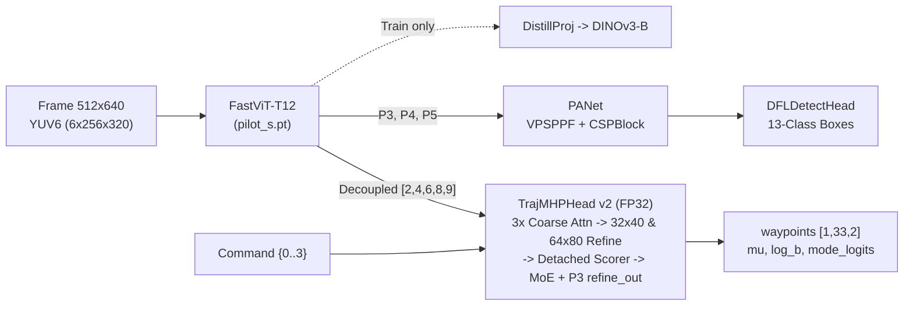
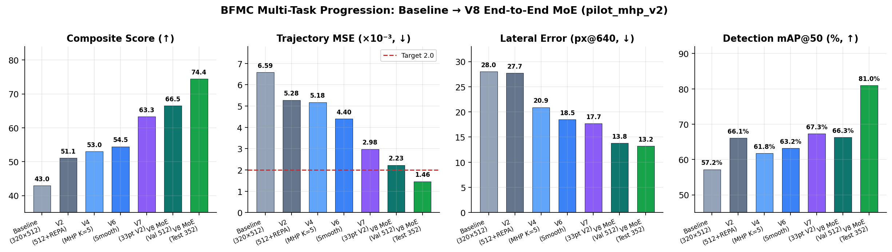
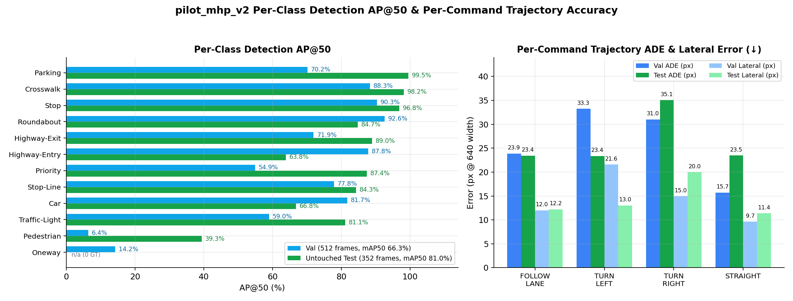
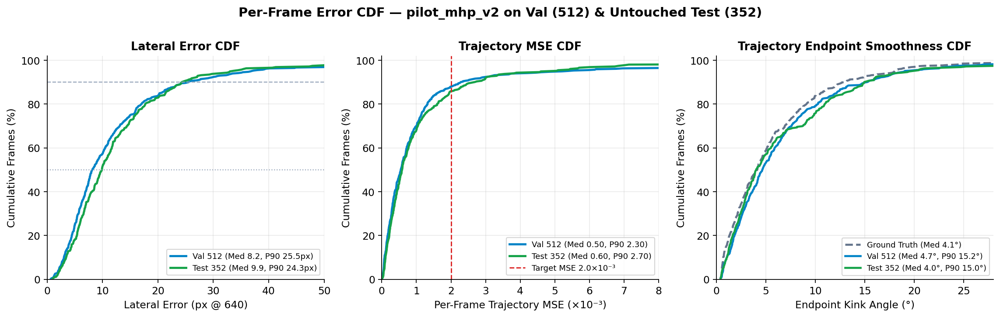
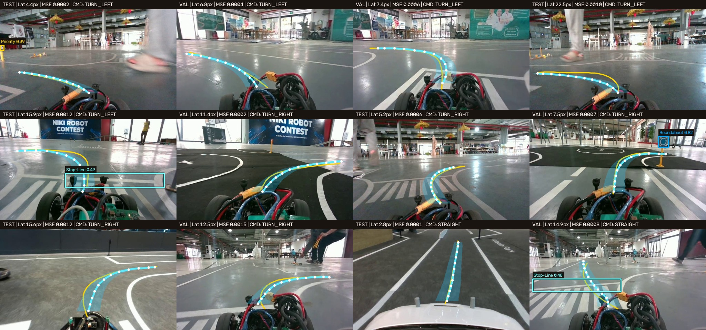
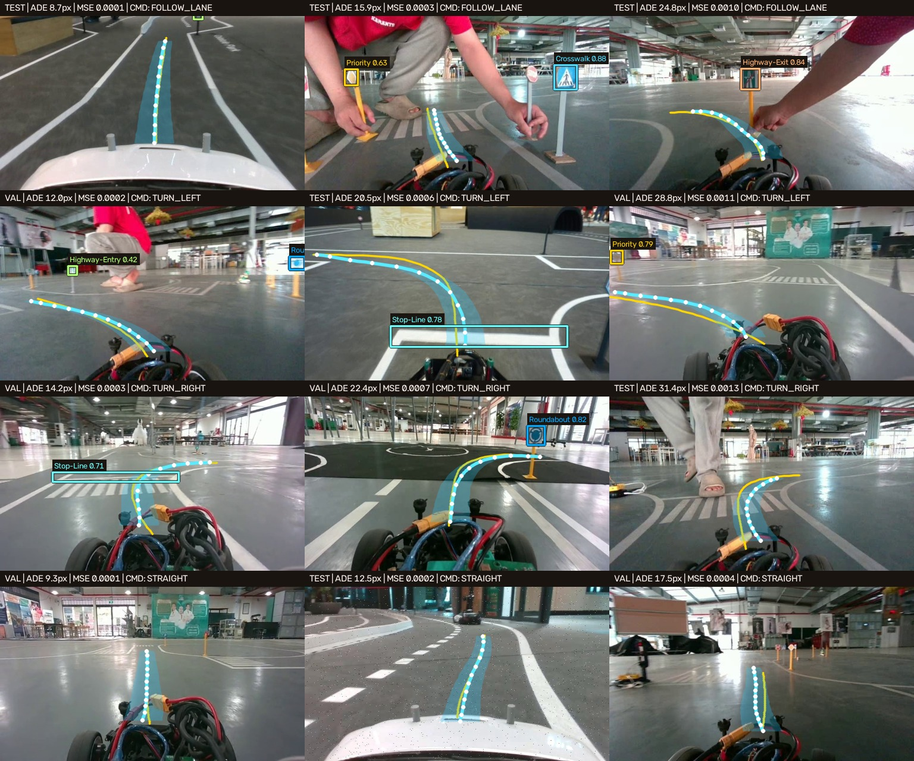

# BFMC 1:10 Experiment Report — V2 (`pilot_mhp_v2`)

> Legacy 10-waypoint baseline and Jetson Orin TensorRT logs are in [`REPORT_V1.md`](REPORT_V1.md).

- **Model:** [`pilot_mhp.yaml`](../../neuro_pilot/cfg/models/zoo/pilot_mhp.yaml) (`scale: v2`, `16.79M` params, `64.25 MB` `.pt`, `64.52 MB` FP32 ONNX)
- **Weights:** `NeuroPilot("pilot_mhp_v2.pt")` (auto-downloaded from [`ThanhNguyenVo/neuropilot-weights`](https://huggingface.co/ThanhNguyenVo/neuropilot-weights))
- **Dataset:** [`ThanhNguyenVo/bfmc-33wp`](https://huggingface.co/datasets/ThanhNguyenVo/bfmc-33wp) (`4,225` frames, 3-way zero-leakage split, `33` B-spline waypoints)
- **Code:** [`export_dataset.py`](export_dataset.py) | [`dataset.py`](dataset.py) | [`train.py`](train.py) | [`metrics.py`](metrics.py) | [`demo.py`](demo.py)

---

## 1. Summary of Results

Initialized from OpenPilot `pilot_s.pt` (`134/134` tensors), selected on the 512-frame Val split, and evaluated once on the untouched 352-frame Test split (`shared_sha = 0`, `min_dhash_hamming >= 7`). Combined 864-frame held-out MSE is **`0.00192`** (`pilot_mhp_v2_traj.pt`: **`0.00188`**), below the `0.0020` target with no overfitting.

| Model / Split | Score (↑) | MSE (↓) | `minMSE@5` (↓) | ADE / Lat (`px@640`) | Curve (`px@640`) | End Kink | Jerk `L2` | `mAP@50` | `Car` AP50 |
|---|---:|---:|---:|---:|---:|---:|---:|---:|---:|
| Ground Truth (Val / Test) | — | `0.00000` | — | `0` / `0` | `0` | `5.9°` / `5.4°` | — | — | — |
| V7 (`33-pt` decoupled, 780 val) | `63.32` | `0.00298` | `0.00158` | `31.2` / `17.7` | `18.9` | `4.9°` | — | `67.3%` | `85.4%` |
| S1 (`33-pt` argmax, 512 val) | `65.89` | `0.00308` | `0.00092` | `28.3` / `15.1` | `16.4` | `6.0°` | — | `68.6%` | `93.0%` |
| **V8 MoE Val 512 (`pilot_mhp_v2.pt`)** | **`66.53`** | **`0.00223`** | **`0.00082`** | **`25.5` / `13.8`** | **`15.0`** | **`6.9°`** | **`0.0071`** | **`66.3%`** | **`81.7%`** |
| V8 MoE Val 512 (`pilot_mhp_v2_traj.pt`) | `65.50` | **`0.00210`** | `0.00084` | **`25.3` / `13.6`** | **`14.9`** | **`6.7°`** | `0.0074` | `64.0%` | `80.2%` |
| **V8 MoE Test 352 (`pilot_mhp_v2.pt`)** | **`74.42`** | **`0.00146`** | **`0.00096`** | **`24.7` / `13.2`** | **`14.4`** | **`6.9°`** | **`0.0078`** | **`81.0%`** | `66.8%` |
| V8 MoE Test 352 (`pilot_mhp_v2_traj.pt`) | `73.03` | **`0.00155`** | `0.00102` | `25.6` / `13.6` | `14.8` | `7.0°` | `0.0081` | `79.5%` | `65.5%` |

### Per-Command Trajectory (`pilot_mhp_v2.pt`)

| Command | Val N | Val MSE | Val ADE / Entry25 / Lat (`px`) | Val Kink | Test N | Test MSE | Test ADE / Entry25 / Lat (`px`) | Test Kink |
|---|---:|---:|---|---:|---:|---:|---|---:|
| `FOLLOW_LANE` | `269` | `0.00179` | `23.9` / `30.3` / `12.0` | `7.8°` | `219` | **`0.00133`** | `23.5` / `28.6` / `12.2` | `6.1°` |
| `TURN_LEFT` | `91` | `0.00411` | `33.3` / `42.1` / `21.6` | `6.9°` | `76` | **`0.00097`** | **`23.4` / `27.5` / `13.0`** | **`5.2°`** |
| `TURN_RIGHT` | `79` | `0.00323` | `31.0` / `42.4` / `15.0` | `7.0°` | `38` | `0.00339` | `35.1` / `45.9` / `20.0` | `14.1°` |
| `STRAIGHT` | `73` | **`0.00045`** | **`15.7` / `11.9` / `9.7`** | **`4.0°`** | `19` | **`0.00105`** | `23.5` / `25.3` / `11.4` | `9.1°` |

---

## 2. Dataset & 3-Way Zero-Leakage Split

Exported by [`export_dataset.py`](export_dataset.py) and published at [`ThanhNguyenVo/bfmc-33wp`](https://huggingface.co/datasets/ThanhNguyenVo/bfmc-33wp).

- **Cleaned & resampled:** Removed `229` non-BFMC frames (CULane/Udacity), fixed reversed paths, and resampled every curve to `33` arc-length C² B-spline waypoints (`y0 > y32`).
- **Zero-leakage audit:** Dropped `55` session-boundary frames and `196` near-duplicate repeat-lap frames. Verified `shared_sha = 0` and `min_dhash_hamming >= 7` across all split pairs (`train↔val = 7`, `train↔test = 7`, `val↔test = 8`).
- **Strict 3-way split (`4,225` frames, `4,082` unique images, `2,950` boxes, 13 classes):**
  - **Train (`ea51bb01e3286646`):** `3,361` frames (`2,334` boxes; `FL:1772, L:827, R:324, ST:438`).
  - **Val (`fc4b193ec4787294`):** `512` frames (`359` boxes, 12 classes; `FL:269, L:91, R:79, ST:73`).
  - **Untouched Test (`50df812d6339b98f`):** `352` frames (`257` boxes, 11 classes; `FL:219, L:76, R:38, ST:19`).
  - **Unlabeled REPA bank & unseen video:** `1,280` train-side frames (`video1..4.mp4`); `bfmc.mp4` (`3,250` frames, `54.2s @ 60 FPS`, excluded from all splits).

---

## 3. Model & Loss Design (`scale: v2`)

### 3.1 Architecture (`pilot_mhp.yaml`, `scale: v2`)

- **Backbone (`layers 0..9`):** `YuvSinglePrep` + OpenPilot pretrained `FastViT-T12` (`pilot_s.pt`).
- **Detection (`layers 10..23`):** PANet (`VPSPPF` + `CSPBlock`) + `DFLDetectHead` for 13 classes on `P3/P4/P5`.
- **Decoupled Trajectory Head (`layer 24`, FP32 `TrajMHPHead` with `cmd_score=True, hi_res=True`):**
  - Taps backbone `[2, 4, 6, 8, 9]` directly so trajectory gradients do not conflict with PANet detection.
  - Builds command-FiLM lane maps at `32×40` (`fine` + path heatmap) and `64×80` (`fine_hi`, fused with raw `P3`).
  - Runs 3 coarse cross-attention blocks over `K=5 × 33` queries on `P5 + P4 + GroupNorm(Stage3) + CoordConv` (`±0.55·tanh` around 5 fanned anchors), followed by 2 FP32 bilinear `grid_sample` stages (`refine1` at `32×40`, `refine2` at `64×80`, `±0.20·tanh`).
  - Scores all 5 modes with `mu.detach()` using heatmap + visual path features (`score_vis`), command token, inter-mode self-attention, and spatial cross-attention (`mode_block`).
  - **Differentiable MoE + P3 `refine_out`:** Replaces brittle discrete `argmax` with posterior expectation followed by final `64×80` refinement:
    $$p = \text{softmax}(\ell), \quad \bar{\mu} = \sum_{k=1}^{5} p_k \mu_k, \quad \bar{q} = \sum_{k=1}^{5} p_k Q_{n,k}, \quad \hat{y} = \bar{\mu} + 0.20\,\tanh\!\left(\Delta_{\text{out}}(\text{RefineOut}(\bar{q}, \bar{\mu}, \mathcal{F}_{64\times 80}))\right)$$
- **Training-Only Distillation ([`distill.py`](../../neuro_pilot/nn/zoo/distill.py)):** Aligns `P4/P5` with frozen DINOv3-B (`32×40` grid). Dropped at export (`0 ms` runtime cost).

### 3.2 Loss Terms & Score

$$\mathcal{L} = \lambda_{\text{det}}\,\mathcal{L}_{\text{det}} + \mathcal{L}_{\text{traj}} + \lambda_{\text{dist}}\,\mathcal{L}_{\text{REPA}}, \qquad \text{Score} = 50\cdot\text{mAP@50} + 50\cdot\max\!\left(0,\, 1 - \frac{\text{ADE}}{0.12}\right)$$

- **Detection (`DetectionLoss`):** Task-Aligned Assigner with `7.5·CIoU + 0.85·BCE + 1.5·DFL`.
- **Direct MoE Trajectory (`0.70×` total):** Horizon-weighted (`w_h: 0.85→1.85`), intersection-boosted (`2×`), and hard-mined (Ep `> 6`) supervision on fused $\hat{y}$: `160·MSE + 100·EntryMSE` (far 25% `idx 25..32`) `+ 12·SL1 + 8·EntrySL1 + 3·FDAT + 10·SymCurve + 12·MonoY`.
- **Auxiliary Multi-Modal Diversity:** `0.45·MHPLaplaceLoss` + `2.0·ModeKL(τ=0.003)` + winner `WTA(40·MSE + 8·SL1 + 4·CoarseSL1)` + `1.2·HeatmapLoss` (`32×40`).
- **Density-Invariant Smoothness (`scale_t = (T-1)/9`):**
  $$\mathcal{L}_{\text{smooth}} = 20\,\text{SL1}(v_{\hat{y}}, v_y) + 32\,\text{SL1}(a_{\hat{y}}, a_y) + 4\,\mathbb{E}\!\left[w_{\text{seg}}(1-\cos(\hat{v}_{\hat{y}}, \hat{v}_y))\right] + 25\,\text{SL1}(j_{\hat{y}}, 0) + 10\,\text{SL1}(j_{\mu_{\text{all}}}, 0)$$
  with $w_{\text{seg}} = 2.5$ on the final 6 segments to prevent endpoint hooks.
- **REPA (`dense_distill_loss`):** Cosine + `0.5·SmoothL1` + `0.5·Gram MSE` on labeled and unlabeled batches.

---

## 4. Training Pipeline & Stages

- **Balanced Curvature Sampler ([`dataset.py`](dataset.py)):** Weights frames by `(1/N_c)^0.55`, `×1.25` for boxes, `×1.45` for `Roundabout`, up to `×1.8` for high curvature, and `×1.85` for CCW roundabout C-arcs (capped at `4.5×` median).
- **Right-Hand-Safe Augmentations & Stability:** Synchronized affine (`±5.5°`, `p=0.65`), symmetric-only patch copy-paste (`p=0.55`), HSV/glare/noise, **no full-frame HFlip**; 3-group AdamW (`det_wd=2e-2`), per-group `clip_grad_norm_(bb=2, det=5, traj=2)`, and `EMA(0.994)`.

| Stage | Init | Precision | LR & Schedule | Augmentations & Weights | Runtime (RTX 3060) |
|---|---|---|---|---|---|
| **1. End-to-End MoE (`EXP-033`)** | `pilot_s.pt` (`134/134`) | `512×640` BF16 + FP32 head | `40 ep` (`freeze=3`, `bs=8`); `bb=2e-4`, `det=1.2e-3`, `traj=6e-4`, Cosine | Affine `p=0.65`, copy-paste `0.55`, **no HFlip**, REPA `1.5`, `det_w=1.8`, `smooth_w=1.0` | `123 min` |
| **2. Anti-Overfit Polish (`EXP-034`)** | `EXP-033` Ep 30 `best_traj` | `512×640` BF16 + FP32 head | `12 ep` (`freeze=0`, `bs=8`); `bb=4e-5`, `det=3e-4`, `traj=1.5e-4`, Cosine | Keep strong aug (`affine=0.65`, `copy_paste=0.55`, REPA `1.2`), `smooth_w=2.2`, `det_w=1.65` | `37 min` |

---

## 5. Experiment Log (`EXP-029` → `EXP-034`)

`EXP-030` → `EXP-034` are evaluated on the identical 512-frame zero-leakage Val split (`dHash >= 7`).

| ID | Change | Status | Ep | Score | Val MSE | Lat (`px`) | Kink | `mAP@50` | Outcome / Root Cause |
|---|---|---|---:|---:|---:|---:|---:|---:|---|
| `029` | V7: `33-pt` decoupled PANet + `cmd_score` (780 val) | Keep | 30 | `63.32` | `0.00298` | `17.7` | `4.9°` | `67.3%` | `TURN_LEFT` ADE `-37.9%`, `Car 85.4%`, `Priority 70.0%` |
| `030` | S1 Attempt 1: undetached `mu` scorer + `64×80` HM | Fail | 10 | `47.15` | `0.00629` | — | `8.0°` | `59.3%` | Early-killed; scorer `grad_norm=162` starved det/traj |
| `031` | S1: Detached scorer + `32×40` HM + per-group clip | Keep | 20 | `65.89` | `0.00308` | `15.1` | `6.0°` | `68.6%` | Oracle `minMSE@5=0.00092`: 70% MSE was discrete argmax gap |
| `032` | S2: Weak-affine (`p=0.30`) discrete argmax polish | Drop | 14 | `65.04` | `0.00294` | `14.8` | `5.3°` | `65.8%` | Overfit after Ep 6; argmax hit hard ceiling |
| `033` | **V8 MoE:** Differentiable MoE + P3 `refine_out` | Keep | 36 | `66.31` | `0.00221` | `13.8` | `6.9°` | `65.9%` | Val MSE `-28.6%` (`0.00210` Ep 30), `TURN_LEFT` Ent25 `-12 px` |
| **`034`** | **V8 Polish (`pilot_mhp_v2.pt`, strong aug kept)** | **Keep** | **10** | **`66.53` / `74.42`** | **`0.00223` / `0.00146`** | **`13.8` / `13.2`** | **`6.9°`** | **`66.3%` / `81.0%`** | **Val / Untouched Test; combined 864-frame MSE `0.00192`** |

---

## 6. Plots & Visual Results

### Training Curves (`EXP-033` + `EXP-034`)

### Stage-by-Stage Progression

### Per-Class Detection & Per-Command Trajectory (Val 512 vs Test 352)
Test AP@50 reaches `Parking 99.5%`, `Crosswalk 98.2%`, `Stop 96.8%`, `Highway-Exit 89.0%`, `Priority 87.4%`, `Roundabout 84.7%`, `Stop-Line 84.3%`, and `Traffic-Light 81.1%` (`mAP@50 = 81.0%`, `mAP@50:95 = 44.8%`).

### Val (512) & Untouched Test (352) Error CDF
- **Lateral error:** Val median `8.2 px`, P90 `25.5 px` | Test median `9.9 px`, P90 `24.3 px`.
- **Per-frame MSE:** Val median `0.0005`, P90 `0.0023` | Test median `0.0006`, P90 `0.0027`.
- **Endpoint kink:** Val median `4.7°`, P90 `15.2°` | Test median `4.0°`, P90 `15.0°` (GT median: `4.1° / 3.4°`).

### Visual Checks (Intersections, Held-Out Val/Test, Unseen `bfmc.mp4`)

---

## 7. ONNX Parity & Runtime

Exported via `model.export_onnx()` (opset 17, pure FP32) and verified across all 4 commands (`FOLLOW_LANE`, `TURN_LEFT`, `TURN_RIGHT`, `STRAIGHT`). Reproducible training and export commands are in [`README.md`](README.md).

| File | Size | `waypoints` Max Diff | `mu` / `log_b` / `logits` Diff | `det` Max Diff | `NeuroPilot(".onnx")` |
|---|---:|---:|---:|---:|---:|
| `pilot_mhp_v2.onnx` | `64.52 MB` | `2.98e-7` (`cos=1.0`) | `3.0e-7` / `3.3e-6` / `8.6e-6` | `1.31e-3` (`cos=1.0`) | `2.98e-7` diff (pass) |

- **GPU (RTX 3060, `512×640` BF16):** Forward `14.23 ms` (`70.3 FPS`); end-to-end incl. YUV6 + NMS `15.76 ms` (`63.5 FPS`); full 3,250-frame `bfmc.mp4` demo at `63.4 FPS`.
- **CPU (x86 ONNXRuntime):** `53.12 ms` (`18.8 FPS`).
- **Jetson Orin Nano (`sm87`):** Build TensorRT 10.3 engine with `--bf16` (per V1 `EXP-028`) to prevent FP16 dark-frame NaNs.
